# Phase 241: Operational evidence and policy inspection - Research

**Researched:** 2026-10-10
**Domain:** Phoenix LiveView operator pages, PostgreSQL trigger inspection, audit evidence presentation
**Confidence:** HIGH for current implementation and scope; MEDIUM for browser and external-documentation guidance

<user_constraints>
## User Constraints (from CONTEXT.md)

### Locked Decisions

#### Phase Boundary

Refine the existing schema-scoped Audit coverage, Evidence, and Redaction policy operator pages so engineers and support/on-call operators can act on capture gaps, understand what evidence was recorded and what it cannot establish, and compare configured policy with deployed trigger policy. Use the existing Phoenix/LiveView routes, host-managed migration workflow, reads, and private UI primitives. Preserve host authentication, authorization, tenant scope, existing route and public 1.x contracts, redaction behavior, and Phoenix optionality. Do not add backend capabilities, public APIs, routes, a role model, dependencies, a component package, or automatic migration application.

#### Schema-scoped capture coverage and migration remediation

- **D-01:** Keep selected-schema coverage as the primary workflow and preserve the validated `?schema=` URL state. Identify every table together with the selected host schema, and keep covered, uncovered, expected-gap, empty, unavailable, and stale last-known results distinct. An inspection failure must never present an empty result as a healthy or confirmed-empty assessment; stale rows must remain visibly labeled with their observation time.
- **D-02:** Make uncovered-table remediation lead to the host-owned generated migration and then the schema-specific coverage verifier. Offer a copyable schema-qualified `mix threadline.gen.triggers --tables SCHEMA.TABLE` command only for conservative identifiers accepted by the generator. For identifiers that cannot be safely rendered as a shell command, keep the exact schema/table visible and provide a manual migration path. The UI never applies a migration.
- **D-03:** Keep cross-schema inventory out of this phase. Preserve the scoped page and direct remediation rather than introducing a broad catalog view or a new health query.

#### Evidence projection, proof history, and completeness limits

- **D-04:** Keep the existing latest-projection → subject-reference proof-history flow. Preserve the selected subject and reference in history navigation, distinguish `summary_status` from the proof assessment, and render only bounded, explicitly approved evidence fields. Do not expose arbitrary host-provided `detail`, `provenance`, or raw maps as generic JSON or copy payloads.
- **D-05:** Distinguish no matching Threadline evidence for the selected subject/reference from disabled access and from a failed/unavailable read. No matching record means no Threadline evidence was recorded for that selection; it does not establish that no underlying activity occurred. A read failure must render an unavailable state rather than crash or reuse the empty state.
- **D-06:** Make the evidence claim boundary explicit: a `proven` assessment applies to the recorded snapshot, `inferred_posture` is inferred, and `unsupported` remains unsupported. Latest projection and append-only history describe recorded Threadline evidence; neither proves overall capture completeness or the absence of unrecorded activity. If a later view applies a time range or result cap, label that scope and its completeness limit. Do not add public evidence APIs, new proof statuses, or history pagination in this phase.

#### Configured and deployed redaction policy

- **D-07:** Keep the per-table normalized comparison of configured `exclude`, `mask`, and placeholder settings against successfully inspected deployed trigger policy. Lead with actionable drift and keep matching rows available for confirmation; show unreadable/unrecognized trigger state separately from a match.
- **D-08:** Treat a known missing trigger for a configured table as `drift_detected` even when the configured redaction policy is empty; preserve the specific missing-trigger warning and migration remediation. Reserve `could_not_introspect` for an existing deployment that cannot be safely interpreted. Keep the documented three-value public status set; do not add a new enum value. A table may enter the all-clear result only after successful inspection confirms a match.
- **D-09:** Never include raw trigger SQL, audit sample values, or redacted values in the presenter report or rendered UI. Keep copy controls limited to safe policy/remediation text. Verify absence of sensitive canaries in HTML and copy attributes; if a copy affordance is added, test the browser's actual clipboard result too. Policy comparison describes current deployed trigger definitions and does not claim historical rows or downstream exports were redacted.

#### Cross-cutting presentation and verification

- **D-10:** Carry forward the approved Threadline identity, equal engineer/operator priority, code-first Impeccable approach, calm and precise domain language, existing tokens and private Phoenix/HEEx primitives, and the current route architecture. Use the most fitting existing representation: responsive table rows for coverage and policy comparison, evidence cards for subject records; do not force unlike evidence into a generic table or nested panels.
- **D-11:** Recheck affected journeys at narrow, intermediate, and desktop sizes, actual browser zoom where available, Light/Dark/System themes, keyboard and touch, visible focus, error/empty/pending/stale states, and reduced motion. Preserve the current boundary between server-owned authorization/scope and validated URL state. Automate behavioral and rendered checks; record tool limitations as evidence gaps, not as passing proof.

### the agent's Discretion

- Choose exact concise status copy, grouping and ordering, disclosure details, and responsive presentation within these decisions and the existing design system.
- Select the smallest meaningful ExUnit and mounted-browser regressions, prove the affected routes and copy paths, and avoid asserting visual structure that does not represent a user task.
- Prefer existing named verification entrypoints and verify that the relevant test files are discovered by CI.

### Deferred Ideas (OUT OF SCOPE)

- All-schema coverage inventory and new health/backend queries — outside the selected-schema inspection scope.
- New evidence public APIs, statuses, pagination, proof signatures, generic raw detail display, or conclusions about unrecorded activity — require separate scope and contract decisions.
- Automatically applying host migrations, adding a new redaction status value, or expanding policy management beyond read-only inspection.
- Export and retention operations remain Phase 242; integrated final review and release recommendation remain Phase 243.
</user_constraints>

<phase_requirements>
## Phase Requirements

| ID | Description | Research Support |
|----|-------------|------------------|
| UIO-02 | “Operators can identify capture coverage gaps in the correct schema and find the corresponding host-migration remediation without mistaking unknown status for healthy coverage.” [VERIFIED: `.planning/REQUIREMENTS.md:33`] | Current zero-count verdict ignores read error; extend error/empty regression coverage and safe schema-qualified remediation. |
| UIO-03 | “Operators can inspect evidence and subject proof history with explicit distinctions among host-recorded evidence, unavailable data and limited completeness.” [VERIFIED: `.planning/REQUIREMENTS.md:34`] | Add an unavailable read state, retain latest-to-history navigation and allowlisted proof fields, and state the recorded-snapshot/completeness boundary. |
| UIO-04 | “Operators can compare configured redaction policy with deployed trigger policy and understand discrepancies without exposing redacted values.” [VERIFIED: `.planning/REQUIREMENTS.md:35`] | Make missing configured-table triggers drift even for empty policy; preserve the three public statuses and expand presenter/rendered canary checks. |
</phase_requirements>

## Summary

This is a focused repair of existing operator surfaces. Keep all three routes, the server-owned authorization and schema scope, the host migration workflow, and private HEEx primitives. No new dependency, public contract, backend capability, route, or migration execution path belongs in the plan. [VERIFIED: `.planning/phases/241-operational-evidence-and-policy-inspection/241-CONTEXT.md:8-10`; `AGENTS.md:9-15,66-74`]

Three current code paths can overstate assurance. Coverage renders a zero-count snapshot as “No audited tables found” even when the snapshot has a query error; its verdict functions test counts before error state. Evidence has no read-error assign or rescue around `fetch_records/3`, so a failed read can crash the LiveView instead of showing unavailable. Redaction currently classifies a missing configured-table trigger as a match when its policy equals the empty/default policy, and the page's all-clear check trusts those counts. [VERIFIED: `lib/threadline/operator_surface/live/coverage_live.ex:152-177,384-415,451-475,540-547`; `lib/threadline/operator_surface/live/evidence_live.ex:23-58,96-104,235-276`; `lib/threadline/policy/redaction_presenter.ex:109-133`; `lib/threadline/operator_surface/live/policy_redaction_live.ex:341-343`]

**Primary recommendation:** change only the state/classification seams and their focused regressions: error-first coverage state; explicit evidence read outcome separate from no rows; missing-trigger-is-drift regardless of configured policy. Extend `Presentation.coverage_remediation/2` to produce a schema-qualified copy command only after both selected schema and table pass the conservative identifier check, retaining the manual path for all other names. Keep redaction comparisons normalized and copy-safe. [VERIFIED: `lib/threadline/operator_surface/presentation.ex:471-496`; `lib/threadline/storage_schema.ex:197-213`; `.planning/phases/241-operational-evidence-and-policy-inspection/241-CONTEXT.md:19,24,29-30`]

## Architectural Responsibility Map

| Capability | Primary Tier | Secondary Tier | Rationale |
|------------|-------------|----------------|-----------|
| Selected-schema coverage state | Frontend Server (LiveView) | Database / Storage | LiveView validates URL scope, calls the health read and maps the result into an operator state; PostgreSQL catalogs supply deployed table/trigger facts. [VERIFIED: `lib/threadline/operator_surface/live/coverage_live.ex:40-68,384-415`; `lib/threadline/health/coverage_schemas.ex:23-51`] |
| Host migration remediation | API / Backend (generator and host integration) | Browser / Client | Threadline generates a migration; the host owns applying it. The UI may disclose a safe command but must never run it. [VERIFIED: `lib/mix/tasks/threadline.gen.triggers.ex:13-18`; `.planning/phases/241-operational-evidence-and-policy-inspection/241-CONTEXT.md:19`] |
| Evidence projection and proof history | API / Backend | Database / Storage | The LiveView selects latest or history reads, maps proof records to an allowlist, and renders recorded Threadline facts; storage contains the records. [VERIFIED: `lib/threadline/operator_surface/live/evidence_live.ex:235-301`] |
| Configured/deployed redaction comparison | API / Backend | Database / Storage | The presenter normalizes configured rules and introspected trigger definition before the LiveView renders them. [VERIFIED: `lib/threadline/policy/redaction_presenter.ex:77-107,135-196`] |
| Responsive and accessible state presentation | Frontend Server (HEEx rendering) | Browser / Client | Existing private UI components render state and the example-app browser lane verifies responsive, keyboard, theme and zoom behavior. [VERIFIED: `lib/threadline/operator_surface/ui/data.ex:56-103`; `examples/threadline_phoenix/e2e/playwright.config.ts:22-29,110-128`] |

## Standard Stack

Do not install packages for this phase; use the current stack and private UI toolkit. The root dependency constraints include `{:ecto_sql, "~> 3.10"}`, `{:postgrex, "~> 0.17"}`, optional `{:phoenix, "~> 1.7"}`, optional `{:phoenix_live_view, "~> 1.0"}`, and optional `{:phoenix_html, "~> 4.0"}`. [VERIFIED: `mix.exs:91-100`]

| Existing component | Locked version | Purpose |
|--------------------|----------------|---------|
| Ecto SQL | `"3.14.0"` [VERIFIED: `mix.lock:10`] | Repository reads and host-owned migration integration. |
| Postgrex | `"0.22.4"` [VERIFIED: `mix.lock:39`] | PostgreSQL adapter and catalog-backed operational reads. |
| Phoenix | `"1.8.13"` [VERIFIED: `mix.lock:32`] | Existing optional host web framework. |
| Phoenix LiveView | `"1.2.11"` [VERIFIED: `mix.lock:34`] | Existing mounted operator pages and parameter patch lifecycle. |
| Phoenix HTML | `"4.3.0"` [VERIFIED: `mix.lock:33`] | Existing HEEx rendering support. |
| Playwright example harness | `"1.60.0"` [VERIFIED: installed `examples/threadline_phoenix/e2e/node_modules/.bin/playwright --version`] | Existing desktop/mobile browser proof; no package change required. |

The project support contract explicitly says “Elixir 1.15 floor / 1.17.3 current, OTP 26 min / 27 current, PostgreSQL 15 min / 16 current” and cautions that current tested values are not a support promise. [VERIFIED: `mix.exs:39-45`]

## Architecture Patterns

### Data and state flow

```mermaid
flowchart LR
  Q[Validated schema or evidence URL state] --> LV[Existing authenticated LiveView]
  LV -->|schema-scoped read| PG[(PostgreSQL catalogs / Threadline evidence)]
  PG -->|records, empty result, or read failure| STATE[Distinct success, empty, unavailable, stale state]
  STATE --> SAFE[Allowlisted proof or normalized policy presentation]
  SAFE --> UI[Private HEEx components and responsive tables/cards]
  UI -->|safe remediation only| HOST[Host-generated migration and host-run verifier]
```



The query parameter is input, not authority: keep current edge validation and host authorization before each data read. LiveView's official security guidance says interactions can be forged and authorization must be checked for each user. [VERIFIED: `lib/threadline/operator_surface/live/coverage_live.ex:40-68`; `lib/threadline/health/coverage_schemas.ex:23-51`; CITED: https://phoenix-live-view.hexdocs.pm/1.2.11/security-model.html]

### Recommended project structure

Keep changes in the existing `lib/threadline/operator_surface/live/` pages, `lib/threadline/operator_surface/coverage/` snapshot, `lib/threadline/operator_surface/presentation.ex`, and `lib/threadline/policy/redaction_presenter.ex`; add focused assertions to the corresponding current ExUnit files and, only if a real route behavior needs browser proof, the existing example-app E2E specs. [VERIFIED: `.planning/phases/241-operational-evidence-and-policy-inspection/241-CONTEXT.md:87-108`; existing source and test paths cited below]

### Pattern 1: Make coverage failure a first-class state

`CoverageLive.fetch_coverage_for_schema/2` already preserves same-schema last-good data and records an error; keep that branch for stale results. For a first read or a selected-schema change, render unavailable before using `all_empty?/1` or readiness counts. The initial topbar hook also assigns an error separately from its zero snapshot, so ensure page verdicts and topbar signals do not contradict each other. [VERIFIED: `lib/threadline/operator_surface/live/coverage_live.ex:384-415,445-475,540-547`; `lib/threadline/operator_surface/coverage/on_mount.ex:69-110`]

The existing bucket type is exactly `@type bucket :: :covered | :uncovered | :expected_uncovered`; keep these established results separate from the error/empty state. [VERIFIED: `lib/threadline/operator_surface/coverage/snapshot.ex:11-18`]

### Pattern 2: Separate evidence read outcome from evidence claim assessment

Keep the selected `subject`, `subject_ref`, and `mode` when history navigation changes, and keep `summary_status` visible separately from the proof label. The current row projection is allowlisted to `id`, `subject`, `subject_ref`, `subject_ref_json`, `summary_status`, `proof_label`, `recorded_at`, and `verdict_status`; do not widen it to arbitrary stored maps. [VERIFIED: `lib/threadline/operator_surface/live/evidence_live.ex:235-301`; `.planning/phases/241-operational-evidence-and-policy-inspection/241-CONTEXT.md:23`]

The current display primitive already defines `values: [nil, "error", "never", "unsupported", "no_data", "permission", "unavailable"]`; prefer the matching existing unavailable/error presentation rather than inventing a new public proof status. [VERIFIED: `lib/threadline/operator_surface/ui/data.ex:56-64`]

The proof contract is explicitly “`proven`”, “`inferred_posture`”, and “`unsupported`” for assessments, while “`invalid_request` and `runtime_failure` are error outcomes, not proof verdicts.” [VERIFIED: `guides/domain-reference.md:115-132`; `lib/threadline/evidence/proof.ex:17-19`]

### Pattern 3: Remediate through host-owned generated migrations

The generator parser accepts a table name or a schema-qualified name and validates the schema and table separately: `raise ArgumentError, "table must be NAME or SCHEMA.NAME, got: #{inspect(value)}"`. [VERIFIED: `lib/threadline/storage_schema.ex:197-213`]

The current remediation helper allows only `schema == "public" and safe_generator_identifier?(table_name)` and otherwise returns `command: nil`; change only this safe construction seam. [VERIFIED: `lib/threadline/operator_surface/presentation.ex:471-495`]

Use the locked copy-command shape `mix threadline.gen.triggers --tables SCHEMA.TABLE` only when both identifiers pass the helper's conservative allowlist; show the exact schema/table and manual migration instruction otherwise. After the host applies its generated migration, provide its selected-schema verifier command. The generator documentation says “Run `mix ecto.migrate` to apply.” [VERIFIED: `.planning/phases/241-operational-evidence-and-policy-inspection/241-CONTEXT.md:19`; `lib/mix/tasks/threadline.gen.triggers.ex:8-18`; `lib/threadline/operator_surface/live/coverage_live.ex:514-515`]

### Pattern 4: Treat policy status as proof of a successful inspection

Keep the three statuses exactly `@group_order [:drift_detected, :could_not_introspect, :config_matches_deployed]`; the docs call this the stable three-state taxonomy. A matching status must require an existing trigger that the presenter successfully parsed and compared. [VERIFIED: `lib/threadline/policy/redaction_presenter.ex:8-12,135-196`; `guides/domain-reference.md:49-53,272`]

The current missing-row branch is `[] ->` and chooses `:config_matches_deployed` when `configured_policy == empty_policy()`. Change this classification so every absent trigger for an explicitly configured table is drift and retains “No deployed Threadline trigger found for configured table.” The page's summary currently considers all-clear when drift and introspection counts are zero; the presenter correction therefore fixes the existing count path without a fourth status. [VERIFIED: `lib/threadline/policy/redaction_presenter.ex:109-133`; `lib/threadline/operator_surface/live/policy_redaction_live.ex:290-343`]

The presenter fetches trigger function source for interpretation, then builds normalized policy rows. Keep the raw source inside that internal parsing path; report/UI rows should contain only normalized policy and safe remediation. [VERIFIED: `lib/threadline/policy/redaction_presenter.ex:77-107,135-196`; `.planning/phases/241-operational-evidence-and-policy-inspection/241-CONTEXT.md:30`]

### Anti-patterns to avoid

- **Counts as proof of successful inspection:** a zero-count `Snapshot` can carry `error`; test error before empty/readiness classification. [VERIFIED: `lib/threadline/operator_surface/coverage/snapshot.ex:4-18,57-65`; `coverage_live.ex:451-475,540-547`]
- **Empty evidence as a read fallback:** a thrown database read is not `[]`; preserve the no-match copy only for a successful query returning no record. [VERIFIED: `lib/threadline/operator_surface/live/evidence_live.ex:38-53,96-104,235-276`]
- **Missing trigger as a no-op policy match:** a configured table with no deployed trigger is drift even if its redaction rules are empty. [VERIFIED: `lib/threadline/policy/redaction_presenter.ex:109-133`; `.planning/phases/241-operational-evidence-and-policy-inspection/241-CONTEXT.md:29`]
- **Unvalidated shell command interpolation:** never put raw URL/table data in a copyable command; validate schema and table independently before formatting the command. [VERIFIED: `lib/threadline/operator_surface/presentation.ex:471-495`; `lib/threadline/storage_schema.ex:197-213`; CITED: https://cornucopia.owasp.org/taxonomy/asvs-5.0/02-validation-and-business-logic/02-input-validation]
- **Policy or evidence as historical completeness proof:** trigger definitions describe current deployment; evidence rows describe recorded Threadline evidence. Neither establishes that all historical changes or downstream exports were redacted. [VERIFIED: `.planning/phases/241-operational-evidence-and-policy-inspection/241-CONTEXT.md:25,30`; `guides/domain-reference.md:96-132`]

## Don't Hand-Roll

| Problem | Don't Build | Use Instead | Why |
|---------|-------------|-------------|-----|
| Empty/error/stale UI states | New state component or extra status enum | Existing `Snapshot`, `UI.Data.empty_state`, `UI.Data.error_state`, and stale banner patterns | Existing component variants include `"unavailable"`; existing selected-schema snapshot retains last-good timestamp/error. [VERIFIED: `lib/threadline/operator_surface/ui/data.ex:56-129`; `coverage_live.ex:384-415,445-449`] |
| Redaction SQL parser | Separate UI/catalog parser or return raw SQL to templates | `RedactionPresenter.build_report/1` and its normalized `configured`, `deployed`, `diff`, `warning`, and `hint` rows | Presenter already owns `pg_trigger` inspection and safe rule interpretation. [VERIFIED: `lib/threadline/policy/redaction_presenter.ex:77-107,135-196`] |
| Migration execution from UI | Shell execution, DB DDL, or an automatic migration action | Copyable generator command plus host's own `mix ecto.migrate` workflow | Capture triggers are installed through host-owned Ecto migrations. [VERIFIED: `AGENTS.md:71-73`; `lib/mix/tasks/threadline.gen.triggers.ex:13-18`] |
| New browser/test framework | New package, harness, or custom visual assertion system | Existing ExUnit LiveView tests and `examples/threadline_phoenix/e2e` Playwright suite | Current test locations and desktop/mobile projects already cover mounted routes and interaction. [VERIFIED: `.planning/phases/241-operational-evidence-and-policy-inspection/241-CONTEXT.md:76-81`; `examples/threadline_phoenix/e2e/playwright.config.ts:22-29`] |

**Key insight:** these failures are result-classification bugs, not missing platform capabilities. Fixing the existing snapshot, read, presentation, and presenter seams can meet the requirements while keeping contracts and dependencies stable. [VERIFIED: `.planning/phases/241-operational-evidence-and-policy-inspection/241-CONTEXT.md:8-10`; source paths above]

## Common Pitfalls

### Zero-count snapshot mistaken for confirmed empty

`all_empty?/1` checks only three counters, and verdict helpers check it before checking `snapshot.error`; a failed first/cross-schema inspection can therefore look empty or healthy. Add a failure-first branch and regression tests for initial and changed-schema failures, while preserving the existing same-schema stale-last-good behavior. [VERIFIED: `lib/threadline/operator_surface/live/coverage_live.ex:152-177,384-415,451-475,540-547`; test cases at `test/threadline/operator_surface/live/coverage_live_test.exs:298-338`]

### Failed read conflated with no record or unsupported proof

`EvidenceLive.handle_params/3` calls `fetch_records/3` without a read-error branch; a successful `nil` exact lookup becomes `[]`, which the renderer shows as “No evidence records yet.” Keep a successful empty result distinct from a failed read and from a valid `unsupported` assessment. [VERIFIED: `lib/threadline/operator_surface/live/evidence_live.ex:32-58,96-104,235-276`; `guides/domain-reference.md:115-132`]

### Generator command is not safe for every valid schema/table

The current copy helper supports only public tables under the conservative lowercase identifier regex and sends all non-public schemas to manual instructions. Expand the command only after checking both schema and table; generator parsing of `SCHEMA.TABLE` is supported, but shell safety still depends on the UI's allowlist. Keep the original selected schema visible and keep an exact manual path for names outside it. [VERIFIED: `lib/threadline/operator_surface/presentation.ex:471-495`; `lib/threadline/storage_schema.ex:197-213`; `.planning/phases/241-operational-evidence-and-policy-inspection/241-CONTEXT.md:19`]

### Empty policy makes absent deployed trigger look green

The current presenter compares missing deployment with `empty_policy()` and can emit a match; an all-clear page can then summarize it as healthy. A missing trigger is a known deployment gap, not an uninspectable existing trigger, so classify it as drift and retain its specific warning. [VERIFIED: `lib/threadline/policy/redaction_presenter.ex:109-133`; `lib/threadline/operator_surface/live/policy_redaction_live.ex:290-343`; test coverage today only uses non-empty missing policy at `test/threadline/policy/redaction_presenter_test.exs:132-137`]

### Sensitive values leak through “helpful” detail or errors

Evidence subject references are host-provided maps; keep the existing field allowlist and avoid rendering arbitrary detail/provenance maps. Redaction tests currently assert sample values do not appear in presenter rows; add HTML and copy-attribute canaries. Do not show raw database exceptions or trigger SQL to make error states more detailed. [VERIFIED: `lib/threadline/operator_surface/live/evidence_live.ex:288-301`; `test/threadline/policy/redaction_presenter_test.exs:331-358`; `.planning/phases/241-operational-evidence-and-policy-inspection/241-CONTEXT.md:23,30`]

## Code Examples

Existing coverage reads are already schema-scoped; keep this call shape and make the resulting error a distinct rendered state: [VERIFIED: `lib/threadline/operator_surface/live/coverage_live.ex:384-415`]

```elixir
coverage = Threadline.Health.trigger_coverage(repo: repo, schema: schema)
snapshot = Snapshot.from_coverage(coverage, last_checked_at: now)
```

Existing evidence selection already separates overview, latest-by-reference, and history reads; preserve these calls and handle read failures at the `handle_params/3` boundary. [VERIFIED: `lib/threadline/operator_surface/live/evidence_live.ex:235-276`]

```elixir
Evidence.list_overview([], evidence_opts(repo, storage_schema_opts))
Evidence.get_latest_subject_ref(subject, subject_ref, evidence_opts(repo, storage_schema_opts))
Evidence.list_subject_ref_history(subject, subject_ref, evidence_opts(repo, storage_schema_opts))
```

The existing generator accepts the locked schema-qualified target form, and the host applies the generated migration itself. [VERIFIED: `lib/threadline/storage_schema.ex:197-213`; `lib/mix/tasks/threadline.gen.triggers.ex:13-18`; `.planning/phases/241-operational-evidence-and-policy-inspection/241-CONTEXT.md:19`]

```sh
mix threadline.gen.triggers --tables SCHEMA.TABLE
mix ecto.migrate
mix threadline.verify_coverage --schema=SCHEMA
```

These are reference commands, not permission for the UI to run them. Generate the copy text only after checking both identifiers against the existing conservative generator-safe predicate; otherwise expose manual guidance. [VERIFIED: `.planning/phases/241-operational-evidence-and-policy-inspection/241-CONTEXT.md:19`; `lib/threadline/operator_surface/presentation.ex:471-495`]

## State of the Art

| Previous behavior | Phase behavior to plan | Impact |
|-------------------|-----------------------|--------|
| A query error with zero counts reaches empty/ready verdict logic. [VERIFIED: `lib/threadline/operator_surface/live/coverage_live.ex:451-475,540-547`] | Render an unavailable state for a failed first or changed-schema read, while keeping stale last-good rows labeled. [VERIFIED: `lib/threadline/operator_surface/live/coverage_live.ex:384-415`; `.planning/phases/241-operational-evidence-and-policy-inspection/241-CONTEXT.md:18`] | Operator cannot mistake failed inspection for confirmed empty/healthy coverage. |
| Empty evidence list is the only display result for a successful no-match; read exceptions are not caught. [VERIFIED: `lib/threadline/operator_surface/live/evidence_live.ex:32-58,96-104`] | Distinguish success with no matching record from unavailable read and disabled access. [VERIFIED: `.planning/phases/241-operational-evidence-and-policy-inspection/241-CONTEXT.md:24`] | Honest evidence availability without new proof status or API. |
| Config-only empty policy and missing trigger can compare as a match. [VERIFIED: `lib/threadline/policy/redaction_presenter.ex:109-133`] | A missing configured-table trigger always means drift; only parsed matching deployment means all-clear. [VERIFIED: `.planning/phases/241-operational-evidence-and-policy-inspection/241-CONTEXT.md:29`; `lib/threadline/operator_surface/live/policy_redaction_live.ex:341-343`] | Eliminates the redaction false-green without changing the public status taxonomy. |

There is no technology migration or package update planned; the phase uses the repository's current Phoenix/LiveView/ExUnit and Playwright versions. [VERIFIED: `mix.lock:10,32-34,39`; `examples/threadline_phoenix/e2e/package.json:1-23`; `.planning/phases/241-operational-evidence-and-policy-inspection/241-CONTEXT.md:10`]

## Project Constraints (from AGENTS.md)

- Preserve the layer boundaries: capture owns triggers and audit persistence; semantics owns action context; operator pages belong to exploration/operations. Keep the existing domain nouns. [VERIFIED: `AGENTS.md:9-27`]
- Keep trigger capture behind generated PostgreSQL triggers and host-owned Ecto migrations; the UI must not apply them. [VERIFIED: `AGENTS.md:66-74`; `.planning/phases/241-operational-evidence-and-policy-inspection/241-CONTEXT.md:19`]
- Prefer named `mix verify.*` / `mix ci.*` entrypoints, keep the full default suite honest, preserve CI job IDs, and keep documentation contracts aligned. [VERIFIED: `AGENTS.md:49-64`]
- Automate UAT and verification by default; ask the maintainer only for secrets, spend, push/publish, or scope decisions. [VERIFIED: `AGENTS.md:76-81`]
- Preserve composability with Plug/Phoenix/Ecto/LiveView and correct-by-default behavior; do not expand Threadline into a SIEM, event store, pgAudit replacement, or warehouse. [VERIFIED: `AGENTS.md:66-74`]

## Environment Availability

| Dependency | Required by | Available | Version / observation | Fallback |
|------------|-------------|-----------|----------------------|----------|
| Mix / Elixir / Erlang | ExUnit and named Mix gates | Yes | Elixir `1.17.3`; Erlang/OTP `27` [VERIFIED: `elixir --version` in active worktree] | None needed for current runtime. |
| PostgreSQL | Catalog-backed tests and operator reads | Accepting connections | Connected test DB reports PostgreSQL `14.17`; project support floor is PostgreSQL 15 [VERIFIED: `pg_isready`, `psql ... select version()`; `mix.exs:39-45`] | Run the project verification lane against its supported PostgreSQL 15 minimum before treating DB-backed results as representative. |
| Node / npm | Example-app browser tests | Yes | Node `v22.14.0`, npm `11.1.0` [VERIFIED: `node --version`, `npm --version`] | None needed. |
| Playwright Chromium | Mounted browser / responsive proof | CLI and macOS browser cache found | Playwright `1.60.0`; local E2E `node_modules/.bin/playwright` exists [VERIFIED: local executable probe] | If the CI browser binaries differ, use `mix verify.example_browser --project=desktop-chromium --project=mobile-chromium` in its configured CI environment. |

No new external dependency is required by the approved phase boundary. [VERIFIED: `.planning/phases/241-operational-evidence-and-policy-inspection/241-CONTEXT.md:10`]

## Validation Architecture

Nyquist validation is enabled: the config contains the exact entry `"nyquist_validation": true`. [VERIFIED: `.planning/config.json:53`]

### Test Framework

| Property | Value |
|----------|-------|
| Framework | ExUnit / Phoenix LiveView tests; Playwright for example-app browser flows. [VERIFIED: `mix.exs:233-265`; `examples/threadline_phoenix/e2e/package.json:1-23`] |
| Config file | Existing root Mix aliases and `examples/threadline_phoenix/e2e/playwright.config.ts`. [VERIFIED: `mix.exs:233-265`; Playwright config] |
| Quick run command | `mix test <focused_test_file>` as documented in AGENTS.md. [VERIFIED: `AGENTS.md:39-42`] |
| Phase gate | `mix ci.all`; its alias runs format, Credo, warning-free compile, tests, and then desktop/mobile Chromium browser checks. [VERIFIED: `AGENTS.md:49-53`; `mix.exs:233-265`] |

### Phase Requirements → Test Map

| Req ID | Behavior | Test type | Automated command | Existing file? |
|--------|----------|-----------|-------------------|----------------|
| UIO-02 | Initial and cross-schema query failures display unavailable; same-schema refresh retains and timestamps last-good; schema-qualified safe command and unsafe-name manual fallback. | LiveView and presentation unit | `mix test test/threadline/operator_surface/live/coverage_live_test.exs test/threadline/operator_surface/presentation_test.exs` | Yes; current tests cover last-good and cross-schema rows, but not initial-error verdict or safe non-public command. [VERIFIED: `test/threadline/operator_surface/live/coverage_live_test.exs:298-338`; `test/threadline/operator_surface/presentation_test.exs:373-397`] |
| UIO-03 | Successful no-match, unavailable read and disabled state are distinct; latest-to-history retains subject/reference; claim scope and sensitive field allowlist remain explicit. | LiveView and browser route state | `mix test test/threadline/operator_surface/live/evidence_live_test.exs` | Yes; history and successful empty are covered, read failure is not. [VERIFIED: `test/threadline/operator_surface/live/evidence_live_test.exs:298-359`] |
| UIO-04 | Missing configured trigger with empty policy is drift and retains warning; three statuses remain; raw SQL and sample canaries stay out of report, rendered HTML and any copy attribute. | Presenter unit, LiveView, browser if copy changes | `mix test test/threadline/policy/redaction_presenter_test.exs test/threadline/operator_surface/live/policy_redaction_live_test.exs` | Yes; non-empty missing trigger and sample-value checks exist; add the empty-policy regression and rendered canaries. [VERIFIED: `test/threadline/policy/redaction_presenter_test.exs:132-137,331-358`; `test/threadline/operator_surface/live/policy_redaction_live_test.exs:139-180`] |

For rendered journeys, add to the existing `operator-route-states.spec.ts` or earned-flow spec only where ExUnit cannot prove the browser behavior. Existing Playwright projects include desktop and mobile Chromium; the route-state suite is bounded to evidence-enabled lanes, and actual 200% tab zoom has a desktop-only extension. [VERIFIED: `examples/threadline_phoenix/e2e/playwright.config.ts:22-29,110-128`; `operator-route-states.spec.ts:20-24`; `operator-earned-flows.spec.ts:177-184`]

### Wave 0 Gaps

- No test framework or fixture setup gap was found. Existing route, presenter, and browser suites are present. [VERIFIED: `.planning/phases/241-operational-evidence-and-policy-inspection/241-CONTEXT.md:76-81`; test files cited in the map]
- Add focused regression cases for: coverage initial-read failure (not “empty”); a successful evidence no-match vs forced read failure; schema-qualified safe command plus unsafe schema/table fallback; and missing-trigger empty-policy drift with HTML/report canary checks. [VERIFIED: current missing cases cited in test map]

## Security Domain

Use current OWASP ASVS 5.0 categories for this web/operator surface. OWASP describes ASVS as a basis for testing application security controls, and its current taxonomy contains validation, authorization, data protection, and security logging/error handling categories. [CITED: https://owasp.org/projects/asvs; https://cornucopia.owasp.org/taxonomy/asvs-5.0]

| ASVS 5.0 category | Applies | Phase control |
|-------------------|---------|---------------|
| V2 Validation and Business Logic | Yes | Validate `?schema=` against the existing allowlist/available schemas and validate the schema/table before constructing a shell command; server-side validation remains authoritative. [VERIFIED: `lib/threadline/health/coverage_schemas.ex:6,23-51`; `presentation.ex:471-495`; CITED: https://cornucopia.owasp.org/taxonomy/asvs-5.0/02-validation-and-business-logic/02-input-validation] |
| V8 Authorization | Yes | Preserve the host-owned authorization callbacks for each existing page; a valid URL parameter never grants access or broadens tenant scope. [VERIFIED: `.planning/phases/241-operational-evidence-and-policy-inspection/241-CONTEXT.md:10,34`; current page tests; CITED: https://cornucopia.owasp.org/taxonomy/asvs-5.0] |
| V14 Data Protection | Yes | Keep subject details, sample values, redacted values, and raw trigger definitions out of UI/clipboard payloads. [VERIFIED: `.planning/phases/241-operational-evidence-and-policy-inspection/241-CONTEXT.md:23,30`; `lib/threadline/operator_surface/live/evidence_live.ex:288-301`; CITED: https://cornucopia.owasp.org/taxonomy/asvs-5.0/14-data-protection/02-general-data-protection] |
| V16 Security Logging and Error Handling | Yes | Show a safe unavailable state on read errors, avoid echoing raw exception details, and do not log sensitive evidence values. [VERIFIED: `.planning/phases/241-operational-evidence-and-policy-inspection/241-CONTEXT.md:24,30`; `lib/threadline/operator_surface/live/evidence_live.ex:32-58`; CITED: https://cornucopia.owasp.org/taxonomy/asvs-5.0/16-security-logging-and-error-handling/05-error-handling] |
| V6 Authentication / V7 Session Management | Inherited, not changed | Keep the host's existing authenticated mount/session wiring; phase changes should not add a new login or session mechanism. [VERIFIED: `.planning/phases/241-operational-evidence-and-policy-inspection/241-CONTEXT.md:10`; CITED: https://cornucopia.owasp.org/taxonomy/asvs-5.0] |
| V11 Cryptography | No new control | This phase adds no cryptographic storage or transport behavior. [VERIFIED: `.planning/phases/241-operational-evidence-and-policy-inspection/241-CONTEXT.md:10`; CITED: https://cornucopia.owasp.org/taxonomy/asvs-5.0] |

### Known threat patterns

| Pattern | STRIDE | Mitigation |
|---------|--------|------------|
| Forged `?schema=` or subject-reference parameters broaden query scope | Spoofing / elevation of privilege | Keep server-side validation and host auth/scope on reads; LiveView interactions are client-controlled. [CITED: https://phoenix-live-view.hexdocs.pm/1.2.11/security-model.html; VERIFIED: `lib/threadline/health/coverage_schemas.ex:6,23-34`]
| Shell injection in a copied trigger-generation command | Tampering / code execution | Never concatenate unvalidated identifiers; allowlist both components and keep a manual path. [VERIFIED: `lib/threadline/operator_surface/presentation.ex:471-495`; CITED: https://cornucopia.owasp.org/taxonomy/asvs-5.0/02-validation-and-business-logic/02-input-validation]
| Trigger SQL, redacted values or raw host-provided evidence maps leak through HTML/copy/logs | Information disclosure | Keep presenter normalization and evidence allowlists; assert sensitive canaries absent from presenter output, rendered HTML, copy attributes, and logs where captured. [VERIFIED: `.planning/phases/241-operational-evidence-and-policy-inspection/241-CONTEXT.md:23,30`; `lib/threadline/policy/redaction_presenter.ex:135-196`; `lib/threadline/operator_surface/live/evidence_live.ex:288-301`]
| Database outage is presented as empty/healthy | Denial of service plus integrity of operator decision | Explicitly represent unavailable and stale states; never turn read errors into successful emptiness. [VERIFIED: `lib/threadline/operator_surface/live/coverage_live.ex:384-415,451-475,540-547`; `lib/threadline/operator_surface/live/evidence_live.ex:32-58,96-104`]

## Assumptions Log

| # | Claim | Section | Risk if wrong |
|---|-------|---------|---------------|
| — | None. Recommendations follow locked context decisions and read source/docs. | — | — |

## Open Questions

1. **No architecture or public-contract question remains for planning.** Context records no unresolved high-impact scope/API/security decision. The planner should still choose the smallest deterministic test seam for forcing an Evidence read failure; that is a test implementation detail, not a user decision. [VERIFIED: `.planning/phases/241-operational-evidence-and-policy-inspection/241-CONTEXT.md:5,23-34`; `test/threadline/operator_surface/live/evidence_live_test.exs:298-359`]

## Sources

### Primary (HIGH confidence)

- `.planning/phases/241-operational-evidence-and-policy-inspection/241-CONTEXT.md` — locked scope, UX boundaries and known implementation gaps.
- `.planning/REQUIREMENTS.md` — UIO-02, UIO-03, UIO-04 acceptance contracts.
- `AGENTS.md` and `.planning/STATE.md` — project architecture, commands and current phase state.
- Existing LiveView, presenter, snapshot, generator, UI primitive and ExUnit sources cited inline — implementation facts and current test coverage.

### Official documentation (MEDIUM confidence)

- [Phoenix LiveView `handle_params/3`](https://phoenix-live-view.hexdocs.pm/1.2.11/Phoenix.LiveView.html) — query parameters and live navigation lifecycle.
- [Phoenix LiveView security model](https://phoenix-live-view.hexdocs.pm/1.2.11/security-model.html) — client-controlled events and repeated authorization checks.
- [PostgreSQL 15 `pg_trigger` catalog](https://www.postgresql.org/docs/15/catalog-pg-trigger.html) — trigger-to-table catalog fields and trigger state interpretation.
- [Ecto `Ecto.Migration`](https://ecto-sql.hexdocs.pm/Ecto.Migration.html) — generated migration and host application workflow.
- [OWASP ASVS project](https://owasp.org/projects/asvs) and [ASVS 5.0 taxonomy](https://cornucopia.owasp.org/taxonomy/asvs-5.0) — current security-control categories.

## Metadata

**Confidence breakdown:**
- Standard stack: HIGH — local `mix.exs`, `mix.lock`, package manifest, and installed runtime were inspected.
- Architecture: HIGH — the locked context and implementation paths agree on the corrective seams.
- Pitfalls: HIGH — each reported false-assurance issue is visible in current source and has a corresponding missing regression.
- Security guidance: MEDIUM — official current Phoenix and OWASP guidance is applied to the existing project boundary.

**Research date:** 2026-10-10
**Valid until:** 2026-11-09 for stable local implementation; recheck tool versions before execution.
