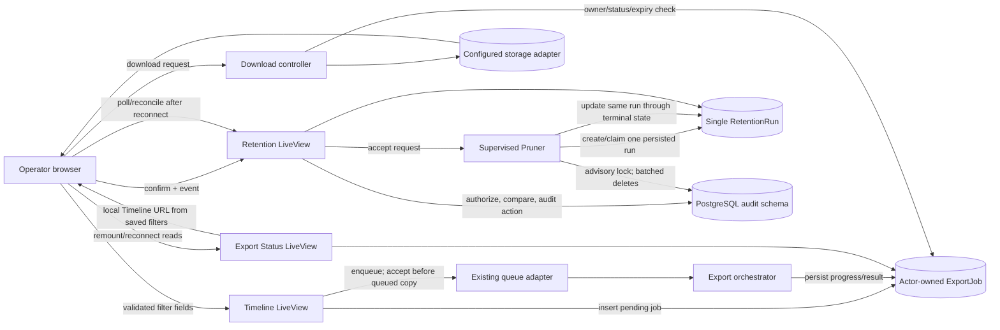

# Phase 242: Export and retention operations - Research

**Researched:** 2026-10-10
**Domain:** Phoenix LiveView operator workflows, persisted asynchronous jobs, Ecto/PostgreSQL retention execution, accessible reconnect recovery
**Confidence:** HIGH for repository behavior and implementation boundaries; MEDIUM for framework guidance from official documentation

<user_constraints>
## User Constraints (from CONTEXT.md)

### Locked Decisions
- **D-01:** Treat the persisted actor-owned `ExportJob` as the lifecycle source of truth. Reconcile from it on remount/reconnect and distinguish pending, running, failed, completed, expired, and missing-file outcomes. Say queued only after the current queue adapter accepts the job; transport loss is not job failure.
- **D-02:** Preserve the source query through the existing validated filter fields and rebuild a local Timeline URL, including an unfiltered fallback. Do not accept arbitrary return URLs, tenant/scope/cursor data, or draft filters. Keep scoped exports unavailable where the current product contract says so.
- **D-03:** The existing per-request download controller remains authoritative for actor ownership, completion, expiry, and storage delivery. Metadata does not prove that the stored file is still usable. Do not add a storage probe on every page refresh or deduplicate intentional repeat export requests.
- **D-04:** Explain the actual global scope: the configured retention policy removes `AuditChange` rows strictly older than the cutoff at execution in the configured Threadline storage schema; when configured, it can also remove empty `AuditTransaction` rows. Host operator/tenant scope is not a prune filter. Do not imply preview counts, a historical cutoff, or per-tenant pruning because the existing run record does not preserve those facts.
- **D-05:** Preserve the existing destructive confirmation path: require the exact canonical policy name, rederive and constant-time compare it server-side, recheck host authorization, and record the audit action before triggering the prune. The UI gate never replaces server authorization.
- **D-06:** Persist acceptance before acknowledging by creating/updating the existing `RetentionRun` record, then update that same record through queued, running, and completed/failed outcomes. Coalesce another request only while a run is active; retain the PostgreSQL advisory lock for cross-node execution exclusion. Record cumulative completed deletions on partial failure and a safe failure category, never raw database/exception detail. Use existing columns and unconstrained text status: no duplicate tracking row, new route/API, public `Threadline.Retention.purge/1` option, schema migration, or dependency. Do not claim exactly-once execution after an arbitrary lost acknowledgment or explicit later retry.
- **D-07:** Keep the current read-only page visible with a programmatically announced reconnect status and clear stale/availability wording. Disable only mutation controls with a keyboard-safe native disabled state during transport loss and in-flight submission; CSS pointer blocking alone is insufficient. Restore controls only after reconnect and fresh authoritative state. Do not make the entire page inert or steal focus.
- **D-08:** Use persisted export and retention state to reconcile after reconnect. Prevent offline activation and in-flight double submission, but do not replay an uncertain mutation or promise exactly-once behavior without a separate idempotency contract.
- **D-09:** Reuse existing Phoenix/LiveView/HEEx patterns, shared status/banner, tokens, and private UI primitives. Keep calm, precise operator language; preserve focus behavior, keyboard/touch access, reduced motion, and responsive layouts. Add no dependency when the existing stack can express the behavior.
- **D-10:** Verify the real mounted journeys: export from source search through delivery and back; confirmation, persisted prune outcome and safe failure; pointer and keyboard behavior across actual disconnect/reconnect; and no accidental duplicate from recovery. Use named verification entrypoints and the smallest meaningful ExUnit/browser regressions.

### the agent's Discretion
- Choose exact concise copy, state grouping/order, and existing components/styles that best express the decisions above.
- Choose the smallest internal runner refactor that creates the existing run record before acknowledgment while preserving documented/public return and error behavior.
- Select focused ExUnit and mounted-browser cases; use actual socket loss where the Phoenix example supports it and describe any unavailable proof honestly.

### Deferred Ideas (OUT OF SCOPE)
- Durable client idempotency keys or exactly-once guarantees across lost acknowledgments; this requires a separate public/API and retry contract.
- Persisting a historical policy/cutoff snapshot or preview count per retention run; this would require a schema and product contract change.
- New event/notification infrastructure, storage probes on every render, arbitrary return URLs, tenant-scoped prune semantics, role models, routes, dependencies, or UI component packages.
- Phase 243 integrated verification and release recommendation.
</user_constraints>

<phase_requirements>
## Phase Requirements

| ID | Description | Research Support |
|----|-------------|------------------|
| UIO-01 | “Authorized operators can complete the existing export journey from its source search through queued/running/failed/completed states to a usable download and return to that search.” [VERIFIED: `.planning/REQUIREMENTS.md:32`] | Persisted actor-owned jobs, adapter acceptance semantics, validated Timeline reconstruction, status/readiness projection, and controller-owned delivery are mapped below. |
| UIO-05 | “Authorized operators can inspect retention runs and complete the existing confirmed prune action with accurate scope, outcome and failure feedback.” [VERIFIED: `.planning/REQUIREMENTS.md:36`] | Existing global policy and run record, confirmation/audit ordering, queued-to-terminal tracking gap, and tests are mapped below. |
| UIA-05 | “Operators receive accurate disconnected/reconnecting feedback, and unavailable mutations cannot be activated by either keyboard or pointer or duplicated during recovery.” [VERIFIED: `.planning/REQUIREMENTS.md:44`] | LiveView lifecycle classes, shared reconnect UI, missing native disabled state, persisted-state reconciliation, and mounted socket-loss test design are mapped below. |
</phase_requirements>

## Summary

Implement this as a completion of three existing journeys. Keep `ExportJob` and `RetentionRun` as durable state, the queue/storage adapters as the existing boundaries, and the host-provided authorization callbacks as the security authority. The implementation should correct state ordering and presentation at the current integration points; no dependency, migration, route, or public contract change is needed. [VERIFIED: `lib/threadline/governance/export_job.ex:12-38`; `lib/threadline/governance/retention_run.ex:10-33`; `lib/threadline/export_queue.ex:50-65`; `lib/threadline/operator_surface/controllers/export_controller.ex:28-114`; Phase decisions D-01–D-10]

The highest risk is retention acknowledgment: `Pruner.trigger/0` currently returns after a cast, while `Retention.purge/1` inserts a run only when execution begins. The same runner then marks success, but an exception can escape without a failed terminal update. Refactor the internal handoff so a persisted run exists before `:ok` is returned, then pass its identity through execution and update that record as progress is known. Keep the existing public `purge/1` behavior by routing its non-operator path through the same internal tracking logic. [VERIFIED: `lib/threadline/retention/pruner.ex:28-37,83-112`; `lib/threadline/retention.ex:101-153`; `lib/threadline/governance/retention_run.ex:10-33`]

For UI recovery, keep content and navigation usable while disconnected, but give each mutation a native disabled state and a submission-in-flight guard. Reconnect should trigger a fresh read of durable records; it must not resend a prune or export. LiveView's server event handlers still need all existing authorization and validation because disabled markup only controls the browser affordance. [CITED: https://phoenix-live-view.hexdocs.pm/1.1.31/js-interop.html; https://phoenix-live-view.hexdocs.pm/1.2.9/security-model.html; https://www.w3.org/WAI/WCAG22/Understanding/status-messages.html; VERIFIED: `lib/threadline/operator_surface/ui/page.ex:238-245,275-296`; `lib/threadline/operator_surface/style/08_overlays_motion.css:271-307`; Phase decisions D-05, D-07, D-08]

**Primary recommendation:** Plan the export return/reconciliation path, a narrow single-record retention runner lifecycle, and mutation-specific reconnect/in-flight gating; prove each with focused LiveView tests plus mounted browser tests that drop and restore the actual LiveView transport. [VERIFIED: phase scope and decisions D-01–D-10; test files listed below]

## Approved UI Contract and State Coverage

The approved design contract is implementation guidance for this phase, not evidence that the current UI passes it. Reuse the source-owned `Threadline.OperatorSurface.UI` private primitives and native HTML controls, existing tokens/routes, and modal/reconnect primitives. The UI-SPEC's listed 49 local components are a non-exhaustive inventory: inspect modules for suitable primitives before creating another one. No UI package, dependency, public component API, route, or visual system is in scope. [CITED: `.planning/phases/242-export-and-retention-operations/242-UI-SPEC.md:5-37`]

Use the exact copy and truth conditions from the approved spec: empty export history is `No export jobs` / `Start an export from Timeline to see its status here.` and appears only after a successful zero-row actor-owned read; retention is `No retention runs` / `A run will appear here after a confirmed prune or scheduled retention operation.` and appears only after a successful zero-run read. Keep loading, read error, empty, export failure, and unavailable file distinct. Queue success copy (`Export queued. You can follow its status here.`) follows adapter acceptance only; persisted job/run state, not a flash, establishes operation status. [CITED: `.planning/phases/242-export-and-retention-operations/242-UI-SPEC.md:91-106,138-150`]

For retention, preserve the spec's global configured-schema scope wording, exact canonical `default` confirmation, and safe-category/partial-count failure wording; do not derive scope from the current operator or tenant, infer a historical cutoff, or expose raw exception details. The modal must use stable title/description IDs with the existing primitive, focus the labeled input on open, contain Tab/Shift+Tab, close through Escape or `Keep audit data` without mutation, and restore focus to its trigger. In-flight submit is natively disabled while the cancel action remains available. [CITED: `.planning/phases/242-export-and-retention-operations/242-UI-SPEC.md:100-106,115-120,154-158,178-180`]

The acceptance inventory covers seven surfaces—export jobs, retention runs, prune confirmation, Timeline source search, export navigation, reconnect status, and mutation controls—with 35 applicable considerations (22 explicit, 13 backstop); the spec says these are acceptance criteria, not passed checks. Carry its responsive/accessibility floors into mounted verification: 320/375/768/1280 CSS-pixel widths and actual browser-chrome 200% zoom; no page-level horizontal overflow; contained local table scrolling is acceptable; wrapping long IDs/categories; 40×40px minimum targets; keyboard and touch; visible focus; Light/Dark/System; reduced motion; and short-height modal reachability. [CITED: `.planning/phases/242-export-and-retention-operations/242-UI-SPEC.md:123-181`]

Exact connection copy is contract-bound: disconnected `Connection lost. Read-only information may be stale; actions are paused until current status is refreshed.` and reconnecting `Reconnecting. Actions will remain unavailable until current status is refreshed.` Keep read-only page and navigation available, don't move focus, refresh durable jobs/runs before reenabling mutations, and never auto-submit or replay. [CITED: `.planning/phases/242-export-and-retention-operations/242-UI-SPEC.md:102-103,117-130,168-180`]

## Architectural Responsibility Map

| Capability | Primary Tier | Secondary Tier | Rationale |
|------------|-------------|----------------|-----------|
| Export lifecycle and actor ownership | API / Backend | Database / Storage | LiveView reads/queues an actor-owned persisted job; HTTP controller verifies the requester and current file delivery on every download. [VERIFIED: `lib/threadline/operator_surface/live/export_status_live.ex:28-44,61-132`; `lib/threadline/operator_surface/controllers/export_controller.ex:28-114`] |
| Source-search return link | Browser / Client | API / Backend | UI reconstructs a local URL from validated saved filters; backend parser remains the authority for supported filters. [VERIFIED: `lib/threadline/operator_surface/live/export_status_live/components.ex:100-105,161-170`; `lib/threadline/operator_surface/live/export_status_live.ex:501-529`] |
| Retention confirmation and authorization | API / Backend | Browser / Client | LiveView renders type-to-confirm UI; event rechecks authorization, validates confirmation, records `AuditAction`, then triggers the supervised pruner. [VERIFIED: `lib/threadline/operator_surface/live/retention_history_live.ex:77-107,378-399`] |
| Retention pruning and run history | API / Backend | Database / Storage | Supervised pruner serializes execution with PostgreSQL advisory locking and writes audit data plus a `RetentionRun` in the configured storage schema. [VERIFIED: `lib/threadline/retention/pruner.ex:48-112,119-128`; `lib/threadline/retention.ex:117-153`; `lib/threadline/governance/retention_run.ex:10-19`] |
| Disconnection and recovery | Browser / Client | API / Backend | LiveView lifecycle classes expose transport state; browser controls the affordance, while server handlers and persisted data govern acceptance/reconciliation. [CITED: https://phoenix-live-view.hexdocs.pm/1.1.31/js-interop.html; VERIFIED: `lib/threadline/operator_surface/style/08_overlays_motion.css:271-307`] |

## Project Constraints (from AGENTS.md)

- Keep capture, semantics, and exploration/operations responsibilities separate; this phase belongs to exploration/operations and does not alter capture boundaries. [VERIFIED: `AGENTS.md` Architecture — Three Layers]
- Preserve domain terms: `AuditTransaction`, `AuditChange`, `AuditAction`, `AuditContext`, `ActorRef`, and `Correlation`. [VERIFIED: `AGENTS.md` Domain Language]
- Preserve trigger-backed capture and host-owned Ecto migrations; this phase must not change that boundary. [VERIFIED: `AGENTS.md` Key Design Constraints]
- Prefer named verification aliases (`mix verify.*` / `mix ci.*`); keep full default tests honest and preserve documentation contract tests. [VERIFIED: `AGENTS.md` Build & Development Commands; CI & Verification Conventions]
- Keep the product composable with Phoenix/LiveView/Ecto/Oban, preserve public 1.x contracts and Phoenix optionality, and do not add dependencies where existing primitives suffice. [VERIFIED: `AGENTS.md` Key Design Constraints; Phase decisions D-06 and D-09]
- Automate verification by default and hand off only scope, secrets, spend, or publication decisions. The phase context says its implementation decisions are settled, so no new scope/API decision is needed for planning. [VERIFIED: `AGENTS.md` GSD / local planning; Phase context Approval]

## Standard Stack

### Core

| Library / system | Version | Purpose | Why Standard |
|------------------|---------|---------|--------------|
| Elixir / OTP | OTP 27 in this environment | Existing supervised pruner and LiveView modules | Keep lifecycle work inside the application's existing OTP supervision and Elixir code. [VERIFIED: `mix --version` output; `lib/threadline/retention/pruner.ex:4-5`] |
| Phoenix LiveView | Example app lock: `1.1.33`; root lock: `1.2.11` | Mounted operator UI, lifecycle bindings, reconnect state | The mounted Phoenix example is the browser acceptance target; check its version-specific behavior against the example lock. The root package lock is distinct. [VERIFIED: `examples/threadline_phoenix/mix.lock:39`; `mix.lock:34`] |
| Ecto / Ecto SQL | Root lock: `3.14.2` / `3.14.0` | Persisted run and job lifecycle | Existing changesets and repository operations already own durable state. [VERIFIED: `mix.lock:9-10`; `lib/threadline/governance/retention_run.ex:21-33`] |
| PostgreSQL | 15 documentation baseline | Advisory lock and configured storage schema | Existing prune exclusion is PostgreSQL-native and must remain paired on a checked-out connection. [VERIFIED: `lib/threadline/retention/pruner.ex:95-128`; CITED: https://www.postgresql.org/docs/15/functions-admin.html] |

### Supporting

| Existing component | Purpose | Use |
|--------------------|---------|-----|
| `Threadline.ExportQueue` adapter | Queue acceptance boundary | Report queued only after adapter `enqueue/2` returns `:ok`; retain failed persistence on explicit `{:error, reason}`. [VERIFIED: `lib/threadline/export_queue.ex:50-65`; `lib/threadline/operator_surface/live/export_status_live.ex:99-125`] |
| `Threadline.Storage` adapter and `ExportController` | Download delivery | Resolve current ownership, status, expiry, and storage delivery at the download request; don't infer file usability from metadata. [VERIFIED: `lib/threadline/operator_surface/controllers/export_controller.ex:28-114`] |
| Shared `UI.Page.shell`, reconnect banner, tokens, and private HEEx primitives | Consistent display and reconnect status | Extend the existing shell and attributes; don't add a component package. [VERIFIED: `lib/threadline/operator_surface/ui/page.ex:275-296`; `lib/threadline/operator_surface/ui/overlay.ex:287-305`] |

**Installation:** None. Phase decisions prohibit adding dependencies; use dependencies already locked in the root package and Phoenix example. [VERIFIED: Phase decisions D-06 and D-09; `mix.lock`; `examples/threadline_phoenix/mix.lock`]

**Package legitimacy audit:** Not applicable; this phase installs no external packages. [VERIFIED: Phase decisions D-06 and D-09]

## Architecture Patterns

### System Architecture Diagram



### Recommended Project Structure

Keep changes within the current feature boundaries: `lib/threadline/operator_surface/live/{timeline_live,export_status_live,retention_history_live}.ex`, `lib/threadline/operator_surface/live/export_status_live/components.ex`, `lib/threadline/retention{,/pruner,/policy}.ex`, and `lib/threadline/operator_surface/style/08_overlays_motion.css`. Add focused tests to the existing matching `test/threadline/...` files and mounted scenarios to the Phoenix example E2E suite. No migration or new package is indicated. [VERIFIED: phase context Canonical References; repository files opened above]

### Pattern 1: Reconcile export from durable state

On mount and after a successful LiveView reconnect, fetch the current actor's persisted jobs and render status from the current records. Keep the server's existing poll timer for progress updates. Derive the Timeline return link from stored validated query fields through the existing canonical filter helper; when the query is empty, use the local Timeline base path without a query string. Keep transport loss separate from the job's own lifecycle, and don't create a retry side effect during a read/reconnect path. [VERIFIED: `lib/threadline/operator_surface/live/export_status_live.ex:28-44,134-145,344-376,501-529`; `lib/threadline/operator_surface/live/export_status_live/components.ex:100-105,161-170`; `lib/threadline/operator_surface/live/timeline_live/filters.ex:14-34`]

`Presentation.export_readiness/2` already handles completed jobs with missing/expired files separately from jobs that are still preparing or failed. The current exact recognized values are: `status in ~w(pending running queued processing)`; `status in ~w(failed error)`; and ready requires `status == "completed" and has_file_path?(file_path) and not expired?(expires_at, opts)` [VERIFIED: `lib/threadline/operator_surface/presentation.ex:283-302`]. Preserve that distinction in rendering and don't advertise a download until the current readiness check permits it; the controller remains authoritative when the user follows the link. [VERIFIED: `lib/threadline/operator_surface/live/export_status_live/components.ex:62-72`; `lib/threadline/operator_surface/controllers/export_controller.ex:70-87`]

### Pattern 2: Accept retention into one durable run

Keep the destructive request ordering in `RetentionHistoryLive`: recheck host authorization, derive the canonical token, compare with `Plug.Crypto.secure_compare/2`, record the action, then ask the pruner to accept. Make the acceptance call persist or coalesce an existing active run before it acknowledges. The worker should transition that exact record into execution and terminal outcome; a history refresh then renders the authoritative row without inferring completion from a flash message. [VERIFIED: `lib/threadline/operator_surface/live/retention_history_live.ex:77-107,378-399`; Phase decision D-06]

The current run schema has the fields `field(:status, :string)`, `field(:deleted_count, :integer)`, `field(:duration_ms, :integer)`, `field(:error_message, :string)`, `field(:started_at, :utc_datetime_usec)`, and `field(:completed_at, :utc_datetime_usec)` [VERIFIED: `lib/threadline/governance/retention_run.ex:10-19`]. Use existing text status and columns. Refactor internal lifecycle coordination so public `Threadline.Retention.purge/1` keeps its current documented result/error contract; do not add a public purge option to pass run IDs. [VERIFIED: `lib/threadline/retention.ex:41-80`; Phase decision D-06]

Retain `repo.checkout/1` around advisory-lock acquisition, execution, and unlock: PostgreSQL session locks live until explicit unlock or session end, and Ecto's checkout provides one checked-out connection over its callback. Use a brief transaction/lock around “find active run or insert one” if cross-node coalescing must be race-safe; retain the existing execution lock for pruning. [CITED: https://www.postgresql.org/docs/15/functions-admin.html; https://ecto.hexdocs.pm/3.13.0/Ecto.Repo.html; VERIFIED: `lib/threadline/retention/pruner.ex:95-128`]

### Pattern 3: Surface truthful disconnected state without losing the page

Use the shared banner's existing polite `role="status"` and actual LiveView transport lifecycle state. Restrict disabled affordance to controls that mutate; use native `disabled` on buttons, and suppress server events with existing server-side guards while the socket is unavailable or the action is already in flight. For reconnect, refresh durable job/run data before reenabling controls; preserve focus and leave read-only navigation and content available. [CITED: https://www.w3.org/WAI/WCAG22/Understanding/status-messages.html; https://phoenix-live-view.hexdocs.pm/1.1.31/js-interop.html; VERIFIED: `lib/threadline/operator_surface/ui/overlay.ex:287-305`; `lib/threadline/operator_surface/style/08_overlays_motion.css:271-307`; Phase decisions D-07–D-08]

### Anti-Patterns to Avoid

- **Calling a cast a durable acceptance:** the current API reports `:ok` after `GenServer.cast/2`; an immediately disconnected/remounted page can miss the later-created run. Insert/coalesce the record before reply. [VERIFIED: `lib/threadline/retention/pruner.ex:28-37`; `lib/threadline/retention.ex:117-135`]
- **Writing a second retention row on worker start:** acceptance and execution need one run identity so progress and final result don't split across rows. [VERIFIED: Phase decision D-06; `lib/threadline/governance/retention_run.ex:10-19`]
- **Allowing exceptions to leave a misleading running row:** persist a safe terminal failure category and cumulative rows deleted after the last successfully completed batch. Never render raw exception/database text. [VERIFIED: `lib/threadline/retention.ex:126-153,214-294`; Phase decision D-06]
- **Treating a failed lock acquisition as a separate prune result:** if another run is active, coalesce/report that existing record; advisory locking prevents simultaneous execution but does not itself collapse multiple queued records. [CITED: https://www.postgresql.org/docs/15/functions-admin.html; Phase decision D-06]
- **Trusting client-supplied return URLs, scope, or operation state:** reconstruct the Timeline path from validated saved fields and keep authorization in server events/controller requests. [CITED: https://phoenix-live-view.hexdocs.pm/1.2.9/security-model.html; VERIFIED: `lib/threadline/operator_surface/live/export_status_live.ex:501-529`; `lib/threadline/operator_surface/controllers/export_controller.ex:28-58`]
- **Using pointer-only disconnected CSS as a keyboard gate:** current CSS only applies `pointer-events: none` and opacity to marked controls; Timeline's background-export button is not marked and the prune submit has no native disabled attribute. [VERIFIED: `lib/threadline/operator_surface/style/08_overlays_motion.css:302-307`; `lib/threadline/operator_surface/live/timeline_live/filters.ex` export form controls; `lib/threadline/operator_surface/live/retention_history_live.ex` prune modal markup]
- **Replaying an uncertain mutation after reconnection:** transport loss does not prove a server operation failed; reconcile from durable state and require a deliberate new action if outcome is still uncertain. [VERIFIED: Phase decisions D-01 and D-08]

## Don't Hand-Roll

| Problem | Don't Build | Use Instead | Why |
|---------|-------------|-------------|-----|
| Export authorization and delivery | UI-side ownership/file checks or repeated storage probes | Existing `ExportController.download/2` and storage adapter | The controller checks owner, current status, expiry, then resolves current local/remote delivery per request. [VERIFIED: `lib/threadline/operator_surface/controllers/export_controller.ex:28-114`] |
| Timeline return URL | Arbitrary client URL parsing or new URL-state format | Existing `FilterParams` canonicalization and `timeline_search_path/2` local construction | Current paths already filter/encode stored query fields and have an empty fallback. [VERIFIED: `lib/threadline/operator_surface/live/export_status_live/components.ex:161-170`; `lib/threadline/operator_surface/live/export_status_live.ex:509-529`] |
| Cross-node execution exclusion | In-memory process flag only | Existing PostgreSQL advisory lock with the current checkout/try/finally release pairing | In-memory state cannot coordinate nodes; session lock gives DB-level exclusion. [VERIFIED: `lib/threadline/retention/pruner.ex:95-128`; CITED: https://www.postgresql.org/docs/15/functions-admin.html] |
| Accessible connection status | New JS framework or page-wide inert overlay | Existing LiveView lifecycle classes and shared `Overlay.reconnect_banner/1` | Existing shell already provides an announced reconnect banner; native disabled state addresses keyboard activation. [VERIFIED: `lib/threadline/operator_surface/ui/overlay.ex:287-305`; CITED: https://www.w3.org/WAI/WCAG22/Understanding/status-messages.html] |

**Key insight:** The persisted record must lead the operator-facing acknowledgment. A live socket, flash, queue return, or completion-shaped metadata alone cannot establish current operation or file availability. [VERIFIED: Phase decisions D-01, D-03, D-06, D-08]

## Common Pitfalls

### Pitfall 1: Acceptance/run race and duplicate runs

**What goes wrong:** `Pruner.trigger/0` currently acknowledges after a cast; the run is inserted only once `Retention.purge/1` starts. A remount can temporarily show no operation, and repeated requests can queue serial purges because the existing lock only excludes concurrent execution. [VERIFIED: `lib/threadline/retention/pruner.ex:28-37,83-112`; `lib/threadline/retention.ex:117-135`]

**How to avoid:** Make acceptance persist/coalesce a run before returning `:ok`; track active status in the existing run row. Reuse execution exclusion, and test simultaneous/rapid requests against the same active run. [VERIFIED: Phase decision D-06; CITED: https://www.postgresql.org/docs/15/functions-admin.html]

**Warning signs:** Run history remains empty after a successful trigger response; repeated click generates separate queued rows; an active row is never refreshed.

### Pitfall 2: Partial deletion with stale/false outcome

**What goes wrong:** A raised DB exception exits the current loop before `run_with_tracking/7` updates completion, so the run can remain in the earlier state and the accumulator of successfully deleted batches is not persisted. [VERIFIED: `lib/threadline/retention.ex:126-153,214-294`]

**How to avoid:** Keep cumulative change/transaction totals outside the exception boundary and checkpoint after completed batches, or return a tagged error that carries the cumulative accumulator. On failure, write a safe category, elapsed time, and completed deletion count to the same row. [VERIFIED: `lib/threadline/governance/retention_run.ex:10-19`; Phase decision D-06]

**Warning signs:** failed DB batch still renders as running; failed run reports zero after earlier committed batches; raw SQL or exception details appear in the LiveView.

### Pitfall 3: Advisory lock released on a different connection

**What goes wrong:** PostgreSQL session advisory locks belong to the session and persist until unlock or session end; acquiring and releasing on separate pooled connections leaks lock ownership or falsely suggests exclusion. [CITED: https://www.postgresql.org/docs/15/functions-admin.html]

**How to avoid:** Preserve `repo.checkout/1` and `try/after` around lock acquisition, prune execution, and unlock. Handle the `false` try-lock result as “another execution owns the lock,” not successful completion. [VERIFIED: `lib/threadline/retention/pruner.ex:95-109,119-128`]

**Warning signs:** future scheduled runs silently skip after one failure; lock is checked out on a separate call; unlock isn't paired on exceptions.

### Pitfall 4: Stale export metadata mistaken for a working file

**What goes wrong:** A completed job with a file path can still be expired or unavailable in current storage. The controller resolves delivery only on the actual request. [VERIFIED: `lib/threadline/operator_surface/presentation.ex:283-302`; `lib/threadline/operator_surface/controllers/export_controller.ex:70-114`]

**How to avoid:** Show “ready” only under existing readiness conditions, surface expired/missing-file distinctly, and let the controller's request result decide actual delivery. Do not probe storage on every render. [VERIFIED: Phase decision D-03; `lib/threadline/operator_surface/presentation.ex:328-382`]

**Warning signs:** download action appears for an expired or pathless job; reconnect is displayed as a failed export; a page refresh makes storage calls for every row.

### Pitfall 5: Reconnect affordance blocks only pointer input

**What goes wrong:** The current shared CSS dims and pointer-blocks `[data-tl-mutating]`; this does not natively disable buttons or block keyboard activation. The export trigger and confirmation submit need to join this existing gate. [VERIFIED: `lib/threadline/operator_surface/style/08_overlays_motion.css:302-307`; `lib/threadline/operator_surface/live/timeline_live/filters.ex`; `lib/threadline/operator_surface/live/retention_history_live.ex`]

**How to avoid:** Add a state-aware native disabled attribute for mutation buttons during disconnected/reconnecting and in-flight state, with server-side authorization and duplicate-submission guards. Keep the banner polite and don't move focus. [CITED: https://www.w3.org/WAI/WCAG22/Understanding/status-messages.html; https://www.w3.org/WAI/ARIA/apg/patterns/button/; https://phoenix-live-view.hexdocs.pm/1.2.9/security-model.html]

**Warning signs:** Tab+Enter or Space still submits during a simulated socket drop; click is disabled but submit event can be forged; read-only content disappears.

## Code Examples

### Preserve current adapter acceptance ordering

The existing pattern creates the job, then calls the queue adapter. Keep user-visible success copy behind the `:ok` response and persist an explicit adapter failure on `{:error, reason}`. The exact current persisted values include `status: "pending"` at insertion and `status: "failed"` on rejection [VERIFIED: `lib/threadline/operator_surface/live/export_status_live.ex:91-124`].

```elixir
job = repo.insert!(ExportJob.operator_changeset(attrs), storage_opts)

case adapter.enqueue(job.id, storage_schema: storage_schema) do
  :ok -> acknowledge_accepted_export(job)
  {:error, reason} -> persist_safe_queue_failure(job, reason)
end
```

This example describes the existing order; do not treat a disconnected client as proof the adapter rejected the job. [VERIFIED: `lib/threadline/operator_surface/live/export_status_live.ex:91-125`; Phase decision D-01]

### Update one tracked retention run

Use Ecto changesets and the existing run fields rather than inserting a new terminal record. This follows Ecto's tracked update pattern and the current `RetentionRun.changeset/2`. [CITED: https://ecto.hexdocs.pm/3.13.0/Ecto.Repo.html; VERIFIED: `lib/threadline/governance/retention_run.ex:21-33`]

```elixir
run
|> RetentionRun.changeset(progress_attrs)
|> repo.update!(storage_opts)
```

Build `progress_attrs` from run identity, cumulative completed deletions, elapsed time, terminal status, and a safe failure category. Confirm exact internal status strings in planning against the locked decision and existing run consumers before writing them; `RetentionRun.status` is a string field, not a compile-time enum. [VERIFIED: `lib/threadline/governance/retention_run.ex:10-19`; Phase decision D-06]

## Validation Architecture

### Test Framework

| Property | Value |
|----------|-------|
| Framework | ExUnit for library and example app; Playwright for mounted example browser tests. [VERIFIED: `test/threadline/operator_surface/live/export_status_live_test.exs`; `examples/threadline_phoenix/e2e/playwright.config.ts`] |
| Config file | `examples/threadline_phoenix/e2e/playwright.config.ts`; ExUnit configured by `test/test_helper.exs` and `examples/threadline_phoenix/test/test_helper.exs`. [VERIFIED: repo paths opened/listed this session] |
| Quick run command | `mix test test/threadline/operator_surface/live/export_status_live_test.exs test/threadline/operator_surface/live/retention_history_live_test.exs test/threadline/retention/pruner_test.exs test/threadline/retention_test.exs test/threadline/operator_surface/controllers/export_controller_test.exs` (run from package root). [VERIFIED: `AGENTS.md` single-file test convention; test paths exist] |
| Mounted browser command | `mix verify.example_browser --grep 'Exports|Retention|offline|reconnect'` uses the named Mix alias; it forwards arguments through `examples/threadline_phoenix/e2e/run-e2e.sh` to `npm test`, whose script runs unit checks then `playwright test`. The named alias itself is `mix verify.example_browser`. [VERIFIED: `mix.exs:163,353-368`; `examples/threadline_phoenix/e2e/run-e2e.sh:518-519`; `examples/threadline_phoenix/e2e/package.json:5-6`] |
| Full suite command | `mix ci.all` after phase work, per project convention. [VERIFIED: `AGENTS.md` Build & Development Commands] |

### Phase Requirements → Test Map

| Req ID | Behavior | Test Type | Automated Command | File Exists? |
|--------|----------|-----------|-------------------|-------------|
| UIO-01 | Persisted actor-owned lifecycle and read truth states; queue acceptance; validated source query and unfiltered local fallback; missing/expired file; owner-safe download; responsive job IDs/actions | LiveView + controller + mounted browser | `mix test test/threadline/operator_surface/live/export_status_live_test.exs test/threadline/operator_surface/controllers/export_controller_test.exs`; `mix verify.example_browser` with focused Playwright selection if forwarded args are confirmed | ✅ ExUnit and `operator-route-states.spec.ts` exist; empty/read-error and source-return/download journey assertions need comparison against the new contract |
| UIO-05 | Successful empty vs read error; newest-first/capped history truth; exact confirmation, authorization recheck, audit-before-prune; same persisted run through partial/terminal failure and global-scope copy | LiveView + pruner/prune integration + mounted browser | `mix test test/threadline/operator_surface/live/retention_history_live_test.exs test/threadline/retention/pruner_test.exs test/threadline/retention_test.exs`; `mix verify.example_browser` | ✅ existing ExUnit files; E2E retention focus case exists, but scope/empty/error/failure copy and activation contracts need mounted checks |
| UIA-05 | Actual transport loss/reconnect copy and status; all mutation buttons natively disabled while disconnected/in-flight; read-only content available; focus undisturbed; fresh authoritative refresh before controls enable; no replay/duplicate | Mounted browser + LiveView regression | `mix verify.example_browser` focused on route-state tests; `mix test` affected LiveView files | ⚠️ export real-socket pointer/keyboard scenarios exist in `operator-route-states.spec.ts:598-629` but capture disabled state instead of asserting it; add acceptance assertions and analogous retention mutation coverage |

**Recommended focused regressions:**

- ExUnit: queue returns success only after adapter acceptance; rejected enqueue becomes failed; exported jobs survive remount under owner filter; empty-filter Timeline return path is local and unfiltered; controller refuses wrong actor, expired job, and missing storage object.
- ExUnit: prune trigger response observes an already-persisted queued run; rapid trigger while active coalesces to one row; failed second batch leaves cumulative count and safe failure category on the same row; lock release still happens when purge raises; authorization/token failure causes no action/prune.
- Browser: strengthen the existing real websocket-loss export tests (they close the actual LiveView socket and currently record disabled attributes without requiring them) to assert exact disconnected/reconnecting copy, native `disabled`, read-only content/navigation availability, and no focus transfer for pointer and Enter/Space activation. Add equivalent prune submit and export trigger coverage plus an in-flight submit case; verify `Keep audit data` stays usable in-flight.
- Browser: verify after reconnection that the page remains unavailable for mutation until persisted jobs/runs have been freshly fetched, then controls re-enable without replay; the job/run count must change only after a new deliberate action. Test server-side forged/repeated events separately because a disabled DOM control is not an authorization boundary.
- Browser: assert exact empty/error/loading distinctions and specified copy for exports and retention; seeded pending/running/failed/completed/expired/missing-file job states; persisted run counts/order/partial failure safe category; validated filter-preserving and empty-filter local Timeline return; download failure retaining the return path.
- Browser: exercise modal label/title/description relationships, initial focus, Tab/Shift+Tab containment, Escape and cancel without mutation, trigger focus restoration, and complete modal body/actions at short viewport height. Check 320/375/768/1280 widths, actual 200% browser zoom, no page overflow, local table overflow only, long identifiers/categories, touch targets, all three themes, visible focus, and reduced motion on affected routes. Use existing responsive/accessibility/motion specs where they cover the same assertions; avoid duplicating broad unrelated suites.

**Sampling:** Run focused ExUnit for affected modules per task, browser journey at the phase gate, then `mix ci.all` before phase verification. This follows named verification conventions; do not infer full suite success from focused files. [VERIFIED: `AGENTS.md` CI & Verification Conventions; Phase decision D-10]

**Wave 0 gaps:** No new framework/dependency installation needed. Promote existing browser evidence probes to assertions for native-disabled/offline behavior, add retention disconnect/in-flight and state-copy/read-error cases, and add focused runner failure/coalescing tests for the acceptance/terminal-run gaps. Existing test files do not yet prove the full approved UI-SPEC acceptance inventory. [VERIFIED: `.planning/phases/242-export-and-retention-operations/242-UI-SPEC.md:134-181`; `examples/threadline_phoenix/e2e/tests/operator-route-states.spec.ts:414-427,598-648`; source test paths listed above]

## Security Domain

Security enforcement is enabled by default because `.planning/config.json` does not set `security_enforcement: false`; this phase changes sensitive download/prune actions. ASVS 5.0.0 is the current OWASP standard shown by its project page. Relevant areas include access control, input validation, data protection, and error handling/logging; the exact ASVS section identifiers should be checked against the chosen version if recorded in a security artifact. [CITED: https://owasp.org/projects/asvs; https://devguide.owasp.org/en/03-requirements/05-asvs/]

| Area | Applies | Standard control |
|------|---------|------------------|
| Access control | Yes | Recheck host authorization in the prune event and owner identity on every download request; UI visibility/disabled state is not authorization. [CITED: https://phoenix-live-view.hexdocs.pm/1.2.9/security-model.html; https://cheatsheetseries.owasp.org/cheatsheets/Authorization_Cheat_Sheet.html] |
| Input validation | Yes | Accept only the exact server-derived confirmation token and validated filter fields; rebuild only local return URLs. [VERIFIED: `lib/threadline/operator_surface/live/retention_history_live.ex:77-107`; `lib/threadline/operator_surface/live/export_status_live.ex:509-529`] |
| Error handling / data protection | Yes | Persist safe failure categories; never expose raw DB/exception text or assume file existence from job metadata. [VERIFIED: Phase decision D-06; `lib/threadline/operator_surface/controllers/export_controller.ex:70-87`] |
| Cryptography | Narrowly applicable | Keep `Plug.Crypto.secure_compare/2` for the typed destructive confirmation; don't replace it with ordinary string equality. [VERIFIED: `lib/threadline/operator_surface/live/retention_history_live.ex` prune event comment/handler at lines 77-107; Phase decision D-05] |
| Authentication / session management | Existing host responsibility | Preserve the host plug/session and LiveView mount boundary; this phase adds no identity or role system. [VERIFIED: Phase boundary; CITED: https://phoenix-live-view.hexdocs.pm/1.2.9/security-model.html] |

### Known Threat Patterns

| Pattern | STRIDE | Mitigation |
|---------|--------|------------|
| Forged export ID or cross-actor download | Spoofing / Information disclosure | Controller parses UUID, fetches current job, compares stable actor references, and only then delivers. Preserve tests for owner mismatch and missing job. [VERIFIED: `lib/threadline/operator_surface/controllers/export_controller.ex:28-68`] |
| Forged confirmation / stale host privilege | Elevation of privilege | Event-level authorization recheck + server-side canonical token and constant-time comparison + audit-before-trigger ordering. [VERIFIED: `lib/threadline/operator_surface/live/retention_history_live.ex:77-107`] |
| Duplicate or uncertain destructive event on reconnect | Repudiation / Tampering | Native disabled state and in-flight guard; durable record reconciliation; don't replay a client mutation. [VERIFIED: Phase decisions D-07–D-08] |
| Database exception leaks query or customer details | Information disclosure | Map failures to safe categories while preserving cumulative completed row counts. [VERIFIED: Phase decision D-06] |

## Environment Availability

| Dependency | Required By | Available | Version | Fallback |
|------------|-------------|-----------|---------|----------|
| Elixir / Mix | ExUnit and named verification | ✓ | Mix 1.17.3; OTP 27 | — |
| Node / npm | Example Playwright E2E | ✓ | Node 26.10.0; npm 11.19.1 | — |
| PostgreSQL client/server | Retention and mounted example DB tests | ✓ | `psql` available; `pg_isready` reports `/tmp:5432 - accepting connections` | — |
| Docker | Example test services if needed | ✓ | 29.5.2 | — |
| Example E2E dependencies | Playwright browser suite | ✓ | `examples/threadline_phoenix/e2e/node_modules` present | — |

No missing dependencies identified. Availability reflects this research worktree's environment; confirm CI uses its named example-app setup before relying on browser proof. [VERIFIED: command probes recorded this session; AGENTS.md named verification convention]

## Sources

### Primary (HIGH confidence for repository facts)

- `.planning/phases/242-export-and-retention-operations/242-CONTEXT.md` — locked phase contract, boundaries, and decisions D-01–D-10.
- `.planning/phases/242-export-and-retention-operations/242-UI-SPEC.md` — approved copy, visual/interaction constraints, truth conditions, responsive/accessibility floors, and explicit acceptance inventory; it is not implementation proof.
- `.planning/REQUIREMENTS.md` and `.planning/ROADMAP.md` — requirement text and phase success criteria.
- `AGENTS.md`, `PRODUCT.md`, and prompts `audit-lib-domain-model-reference.md`, `threadline-elixir-oss-dna.md` — project boundaries and domain/verification conventions.
- `lib/threadline/operator_surface/live/export_status_live.ex`, `export_status_live/components.ex`, `timeline_live.ex`, `timeline_live/filters.ex`, `presentation.ex`, `controllers/export_controller.ex`, `export_queue.ex`, `governance/export_job.ex` — existing export lifecycle, source reconstruction, queue, and download behavior.
- `lib/threadline/operator_surface/live/retention_history_live.ex`, `retention.ex`, `retention/pruner.ex`, `retention/policy.ex`, `governance/retention_run.ex` — prune confirmation, persistence, configured scope, and lock behavior.
- Matching existing ExUnit and example Playwright test files listed in Validation Architecture.

### Official external documentation (MEDIUM confidence; sourced in this session)

- Phoenix LiveView 1.1.31 JavaScript interoperability — lifecycle bindings and server-bound event behavior: https://phoenix-live-view.hexdocs.pm/1.1.31/js-interop.html
- Phoenix LiveView 1.2.9 Security Model — server-side authorization for LiveView events: https://phoenix-live-view.hexdocs.pm/1.2.9/security-model.html
- Ecto Repo 3.13.0 — repository checkout and tracked update operations: https://ecto.hexdocs.pm/3.13.0/Ecto.Repo.html
- PostgreSQL 15 Administration Functions — advisory locks: https://www.postgresql.org/docs/15/functions-admin.html
- W3C WCAG 2.2 SC 4.1.3 Status Messages — announce state changes without requiring focus: https://www.w3.org/WAI/WCAG22/Understanding/status-messages.html
- WAI-ARIA APG Button Pattern — native button role/state interaction model: https://www.w3.org/WAI/ARIA/apg/patterns/button/
- OWASP ASVS project and developer guide — verification areas and current edition: https://owasp.org/projects/asvs; https://devguide.owasp.org/en/03-requirements/05-asvs/
- OWASP Authorization Cheat Sheet — check permission on every request: https://cheatsheetseries.owasp.org/cheatsheets/Authorization_Cheat_Sheet.html

## Assumptions Log

| # | Claim | Section | Risk if Wrong |
|---|-------|---------|---------------|
| A1 | [ASSUMED] The example app's pinned LiveView 1.1.33 retains the lifecycle/disabled-control behavior described by official 1.1.x/1.2.x docs; the phase context explicitly identifies installed 1.1.33 as final compatibility authority. | Standard Stack / reconnect | Browser test may reveal version-specific behavior; use actual disconnect proof. |
| A2 | [ASSUMED] A short transaction-scoped advisory lock around active-run lookup and insert is acceptable for race-safe cross-node coalescing while preserving the current session-scoped execution lock. | Pattern 2 | Could add brief contention; validate lock key use and transaction semantics in implementation review. |
| A3 | [ASSUMED] Mapping database failures to a finite safe category can be implemented without changing public error behavior of `Threadline.Retention.purge/1`. | Pattern 2 / Security | If callers currently rely on exact raised exception details, internal safe tracking must preserve the documented public raising behavior. |

## Open Questions (RESOLVED)

1. **(RESOLVED)** Which existing private/internal function should own the shared run lifecycle?
   - What we know: the public `Threadline.Retention.purge/1` currently creates and completes a run; the operator's supervised path calls that function only after a cast.
   - What's unclear: whether the least invasive extraction is a private runner module or a coordinator callback threaded internally.
   - Recommendation: factor a small internal runner API used by both public `purge/1` and `Pruner`, keeping the public signature, result, and error behavior unchanged; planner should make this a bounded task, not redesign retention.
   - Resolution adopted in `242-02-PLAN.md`: keep the shared lifecycle at the existing private `Retention`/`Pruner` boundary, create or claim one `RetentionRun` before operator acknowledgment, pass its ID into execution, and route scheduled and direct purge paths through the same private tracking seam. Preserve the public `purge/1` signature, success/error results, and reraising behavior. Do not add a public option, schema, or dependency.

2. **(RESOLVED)** How should automatic scheduled purges appear beside an operator-accepted active run?
   - What we know: the pruner schedules itself and uses the same execution lock; policy and schema are process-level configuration.
   - What's unclear: whether a scheduled tick encountering an active operator run should simply coalesce/skip and retain the active row's progress.
   - Recommendation: have all callers pass through the same active-run check; never create a second row for a skipped/coalesced request.
   - Resolution adopted in `242-02-PLAN.md`: operator triggers and scheduled ticks use the same active-run acceptance check. A scheduled tick encountering a queued/running run coalesces/skips without creating a second row or execution; after terminal state, a later deliberate request may create a new run. The PostgreSQL advisory lock remains the cross-node execution exclusion mechanism.

## Confidence Assessment

| Area | Level | Reason |
|------|-------|--------|
| Standard stack | HIGH | Current root and example lockfiles and source usage were opened; no package additions are in scope. |
| Architecture | HIGH | Existing modules and lifecycle paths were inspected directly; locked decisions constrain remaining implementation choices. |
| Pitfalls | HIGH | Acceptance gap, stale file metadata, pointer-only reconnect gate, and exception path are visible in source; external semantics are supported by official PostgreSQL, Ecto, Phoenix, and W3C docs. |

**Research date:** 2026-10-10
**Valid until:** 2026-11-09 for this stable implementation domain; recheck dependency docs if package versions change.
