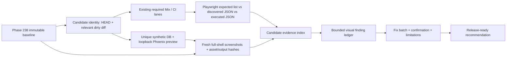

# Phase 243: Integrated verification and review preview — Research

**Researched:** 2026-10-11  
**Domain:** Phoenix example preview, Playwright journey verification, source-bound rendered evidence, CI coverage receipts  
**Confidence:** HIGH for repository architecture and existing behavior; MEDIUM for external framework guidance, cited from official documentation.

## User Constraints

No Phase 243 `CONTEXT.md` is present (`init.phase-op 243` reports `has_context: false`). For this research, honor the user's explicit defaults: research the relevant decision lenses, synthesize one coherent recommendation, prefer primary sources, reuse current tools and dependencies, and automatically follow clear recommendations. The user prefers a small dependency tree and accepts a new dependency only when the existing stack cannot do the job.

## Phase Requirements

| ID | Description | Research Support |
|----|-------------|------------------|
| UIV-01 | “Maintainers can run automated checks for the supported journeys and material failure cases and verify that the intended regression tests are discovered and executed by required CI.” [VERIFIED: `.planning/REQUIREMENTS.md:50`] | Add a small journey-to-test inventory and a CI receipt that reconciles its exact test identities against Playwright's discovered list and JSON run results in the existing required browser job. |
| UIV-02 | “Maintainers can compare trustworthy before/after rendered evidence and a bounded agent visual review, with normal verification leaving baselines unchanged and concrete findings fixed or explicitly dispositioned.” [VERIFIED: `.planning/REQUIREMENTS.md:51`] | Preserve the accepted Phase 238 baseline, render fresh full-shell candidate captures with the same browser/OS/fixture settings where possible, and record bounded findings, corrective batch, confirmation and explicit limitations. |
| UIV-03 | “Maintainers can review the finished UI in a reproducible preview tied to the delivery candidate, accompanied by the verified coverage, remaining limitations and release-ready recommendation.” [VERIFIED: `.planning/REQUIREMENTS.md:52`] | Refresh the existing local Phoenix preview receipt with candidate identity, effective dirty diff, fixture and served-asset hashes; provide one evidence index covering CI, visual review, limitations and release recommendation. |

## Summary

Phase 243 is an integration and evidence-custody phase. The repository already has the right components: named Mix verification aliases; required desktop/mobile Chromium jobs; Playwright list mode and JSON reporter support; an isolated synthetic preview runner; Phase 238 source/asset/output manifests; and current journey, accessibility, zoom and degraded-state specs. Keep these parts and connect them with a compact candidate-level receipt. [VERIFIED: `mix.exs:131-165,233-265`; `examples/threadline_phoenix/e2e/playwright.config.ts:22-24,134-161`; `examples/threadline_phoenix/e2e/run-e2e.sh:77-168`; `examples/threadline_phoenix/e2e/support/operator-evidence-manifest.ts:30-50,148-173`]

The three decision tracks cohere: use Playwright's existing JSON reporter to prove the expected journey tests were both discovered and executed in the existing required CI lane; capture fresh candidate screenshots into a unique ignored artifact directory and compare them against the immutable Phase 238 evidence in a controlled browser environment; then reopen the existing guarded loopback Phoenix preview and present the receipts, findings and limitations together. Do not create a hosted preview service, introduce a visual-testing package, add a new CI job, or revive the old paid/pixel-ratchet critic. [VERIFIED: `.github/workflows/ci.yml:951-979,1075-1095,1097-1125`; `.planning/phases/238-current-main-preview-and-acceptance-baseline/238-EVIDENCE-INDEX.md:1-24`; `.planning/REQUIREMENTS.md:84-95`; [CITED: Playwright JSON reporter](https://playwright.dev/docs/test-reporters); [CITED: Playwright visual comparisons](https://playwright.dev/docs/test-snapshots)]

**Primary recommendation:** Produce one exact-candidate evidence index that joins (a) expected/discovered/executed journey test identities from the required job, (b) before/after full-shell capture manifests and a bounded finding ledger, and (c) a guarded local preview receipt. Expand candidate hashing to cover verification tooling and workflow inputs as well as UI/runtime code; otherwise changes to CI or the evidence runner can escape the current filtered digest. [VERIFIED: `examples/threadline_phoenix/e2e/support/operator-evidence-manifest.ts:148-173`; Phase 238 receipt, `.planning/phases/238-current-main-preview-and-acceptance-baseline/238-PREVIEW-RECEIPT.json`; `.github/workflows/ci.yml:951-979`]

## Architectural Responsibility Map

| Capability | Primary Tier | Secondary Tier | Rationale |
|------------|-------------|----------------|-----------|
| Candidate journey behavior and authorization | API / Backend | Browser / Client | Existing server-side LiveView/controller checks remain authoritative; browser affordances only observe these journeys. |
| Authenticated seeded UI rendering and served-asset identity | Frontend Server (SSR) | Browser / Client | The Phoenix example server renders the host-mounted operator routes and serves assets that the capture receipt compares with local bytes. |
| Journey discovery, execution and responsive/accessibility assertions | Browser / Client | API / Backend | Playwright drives the mounted UI and exercises server responses through the configured Chromium projects. |
| Candidate receipt, test list/run reconciliation and finding disposition | API / Backend (verification tooling) | — | Deterministic scripts/contracts assemble evidence; they do not add product routes or alter audit data. |
| Synthetic fixture and isolated preview database | Database / Storage | Frontend Server (SSR) | Each evidence run uses a unique local test partition and seeded synthetic records; never use a shared development or production database. |
| Raw screenshots, manifests and workflow diagnostics | Database / Storage (artifact custody) | Browser / Client | Store raw visual files outside committed snapshots; persist compact hashes, paths, conditions and judgments in the phase evidence index. |

## Standard Stack

### Core

| Library / Tool | Version | Purpose | Why Standard |
|---|---:|---|---|
| Phoenix | `1.8.13` | Example app preview and routes | Existing locked application stack. [VERIFIED: `examples/threadline_phoenix/mix.lock:36`] Verbatim lock value: `"phoenix": {:hex, :phoenix, "1.8.13"`. |
| Phoenix LiveView | `1.1.33` | Mounted operator journeys and transport state | Existing example-app dependency. [VERIFIED: `examples/threadline_phoenix/mix.lock:39`] Verbatim lock value: `"phoenix_live_view": {:hex, :phoenix_live_view, "1.1.33"`. |
| Playwright Test | `1.60.0` | Browser journey execution, list mode, screenshots, JSON run report | Already locked and installed under the example E2E app. [VERIFIED: `examples/threadline_phoenix/e2e/package-lock.json:491-499`] Verbatim lock values: `"node_modules/@playwright/test":`, `"version": "1.60.0"`, `"playwright": "1.60.0"`. |
| Mix aliases / GitHub Actions | Repository-defined | Reuse required verification and CI topology | Existing contributor-facing commands and required checks; no new test framework. [VERIFIED: `AGENTS.md:49-64`; `mix.exs:233-265`; `.github/workflows/ci.yml:951-979,1075-1125`] Verbatim entrypoints: `mix verify.format`, `mix verify.credo`, `mix verify.test`, `mix ci.all`. |
| PostgreSQL | Existing test service | Isolated synthetic preview and mounted app data | Current E2E runner derives the database from a unique Mix test partition and refuses an existing target before reset. [VERIFIED: `examples/threadline_phoenix/e2e/run-e2e.sh:77-99,141-162`] |

No package installation is recommended. Preserve the existing Playwright/Node, Phoenix/LiveView, ExUnit and GitHub Actions stack; no package legitimacy audit applies because the phase adds no external dependency. [VERIFIED: `examples/threadline_phoenix/e2e/package.json:24-31`; `.planning/phases/242-export-and-retention-operations/242-VALIDATION.md`, “Wave 0 Requirements”]

### Alternatives Considered

| Instead of | Could use | Tradeoff | Recommendation |
|---|---|---|---|
| Existing local Phoenix preview | Hosted ephemeral preview deployment | Easier sharing, but adds deployment/auth/data custody, secrets, lifecycle, and spend concerns outside the phase's need. | Keep the guarded loopback preview. Phoenix's endpoint is the application/server boundary; the current runner already enforces local binding and explicit lifecycle. [VERIFIED: `examples/threadline_phoenix/e2e/run-e2e.sh:77-99,181-220`; [CITED: Phoenix.Endpoint](https://phoenix.hexdocs.pm/Phoenix.Endpoint.html)] |
| Playwright's JSON reporter plus small contracts | New test-result/reporting dependency or custom reporter service | Duplicates the installed runner and creates another format to keep correct. | Use the built-in JSON reporter for executed statuses and the built-in list mode for discovery. [CITED: Playwright reporters](https://playwright.dev/docs/test-reporters), [Playwright CLI](https://playwright.dev/docs/test-cli) |
| Fresh images/manifests under ignored run output | New committed snapshot suite or hosted visual-regression platform | Creates a baseline approval/retention workflow and pixel churn, beyond the bounded review requirement. | Preserve Phase 238 references unchanged; write candidate captures to a new path and use a bounded agent comparison. [VERIFIED: `.planning/REQUIREMENTS.md:84-95`; [CITED: Playwright visual comparisons](https://playwright.dev/docs/test-snapshots)] |
| Compact local evidence index and preview receipt | Upload every successful screenshot/trace bundle to GitHub | Artifact hosting helps remote reviewers but increases data exposure and retention/cost work; workflow artifacts expire per policy. | Keep successful raw captures local/ignored with output hashes and a compact durable index. Upload only selected synthetic artifacts if later cross-machine review proves necessary; keep diagnostics already uploaded on failure. [VERIFIED: `.github/workflows/ci.yml:1085-1095`; [CITED: GitHub workflow artifacts](https://docs.github.com/en/actions/concepts/workflows-and-actions/workflow-artifacts)] |

## Architecture Patterns

### System Architecture Diagram



### Recommended Project Structure

Keep the existing structure and add only the smallest Phase 243 contract/receipt files where useful:

```text
.planning/phases/243-integrated-verification-and-review-preview/
├── 243-RESEARCH.md
├── 243-PLAN.md (planner output)
├── 243-VALIDATION.md (Nyquist output)
├── 243-EVIDENCE-INDEX.md (compact final candidate index)
└── 243-PREVIEW-RECEIPT.json (machine-local process/data custody if needed)

examples/threadline_phoenix/e2e/
├── run-e2e.sh
├── playwright.config.ts
├── tests/                     # extend existing journey specs only where a real gap exists
└── artifacts/operator-evidence/<fresh-unique-run>/  # ignored raw images/manifests
```

Paths above are target locations, not claims that all files already exist. The runner creates evidence output below `examples/threadline_phoenix/e2e/artifacts/operator-evidence/`; its existing creation code is `EVIDENCE_ROOT="$E2E_DIR/artifacts/operator-evidence/$partition"`. [VERIFIED: `examples/threadline_phoenix/e2e/run-e2e.sh:159-163`]

### Pattern 1: CI Coverage Receipt from Native Playwright Output

**What:** Maintain a short journey inventory that names each critical route/state/failure class and the exact Playwright test identity expected to prove it. In the existing required browser step, collect the discovered set using `--list --reporter=json`, run through the existing `mix verify.example_browser` entrypoint with `--reporter=json` directed to a unique output path, then assert each required identity appears in the discovered and executed reports with a passing status. The receipt records source SHA, relevant diff digest, workflow/job/run identity, selected projects, expected/discovered/executed identities, intentional skips and result counts. This separates “spec string still exists,” “test was found,” and “test actually ran.” [CITED: Playwright CLI `--list` and reporter options](https://playwright.dev/docs/test-cli), [Playwright JSON reporter](https://playwright.dev/docs/test-reporters)

**When to use:** For required regression evidence where project filters, light-theme compile-time registration, selectors or test renames can silently produce a green zero/partial run. [VERIFIED: `examples/threadline_phoenix/e2e/playwright.config.ts:5-13,110-132`; `test/threadline/browser_full_projects_contract_test.exs:100-177`]

**Example command shape:**

```bash
cd examples/threadline_phoenix/e2e
PLAYWRIGHT_JSON_OUTPUT_FILE="$TMPDIR/threadline-discovered.json" \
  ./node_modules/.bin/playwright test --list \
  --project=desktop-chromium --project=mobile-chromium --reporter=json
```

The command uses the project names read verbatim from `playwright.config.ts`: `name: "desktop-chromium"` and `name: "mobile-chromium"`. [VERIFIED: `examples/threadline_phoenix/e2e/playwright.config.ts:22-24`] Playwright documents `PLAYWRIGHT_JSON_OUTPUT_FILE` for JSON output; use a different fresh destination for the executed run. [CITED: Playwright reporters](https://playwright.dev/docs/test-reporters)

**Local probe:** From the E2E directory, `./node_modules/.bin/playwright test --list --project=desktop-chromium --project=mobile-chromium` discovered 480 tests in 30 files in this checkout. The same command from the worktree root failed with “Project(s) ... not found” because it did not load the E2E configuration. Treat counts as observed diagnostics, not a contract; assert identities and statuses and execute from the E2E working directory. [VERIFIED: Playwright CLI probe from `examples/threadline_phoenix/e2e`; `playwright.config.ts:134-161`]

### Pattern 2: Immutable Before / Fresh Candidate Visual Evidence

**What:** Do not mutate the Phase 238 baseline or reference snapshots during normal verification. Use a fresh generated run directory for candidate captures; record exact baseline/candidate source identity, relevant code and evidence-tool diff digests, fixture manifest/semantic ID, route and state, actor/scope, theme, viewport, browser/Playwright versions, motion/clock conditions, served asset bytes and output SHA-256. Capture the full shell (navigation/header and main content), not only `#tl-main`, per the requirement. Review a bounded set of coherent findings, apply one corrective batch, then capture confirmation evidence and classify each finding as fixed or explicitly dispositioned. [VERIFIED: `.planning/REQUIREMENTS.md:84-95`; `.planning/phases/238-current-main-preview-and-acceptance-baseline/238-EVIDENCE-INDEX.md:1-24`; `examples/threadline_phoenix/e2e/support/operator-evidence-manifest.ts:30-50,152-173`]

**Rendering-engine caution:** Raster output varies by operating system, browser version, settings and hardware. For a pixel-level or side-by-side comparison, capture the baseline and candidate in the same browser and environment; otherwise label the environment difference and avoid treating every changed pixel as a defect. Playwright's official screenshot guidance recommends the same environment for stable references. [CITED: Playwright visual comparisons](https://playwright.dev/docs/test-snapshots)

**Accessibility/design scope:** Keep the already proven 320 CSS-pixel reflow, actual desktop browser zoom, visible focus, keyboard/touch, semantic names, reduced motion, themes and truthful operation states. 320 CSS-pixel reflow and 200% text/actual browser zoom are distinct evidence; the W3C reflow criterion includes an exception for genuinely two-dimensional content, so table scrolling may remain local while page controls must remain usable. [VERIFIED: `.planning/REQUIREMENTS.md:70-80`; [CITED: W3C WCAG 2.2 Reflow](https://www.w3.org/WAI/WCAG22/Understanding/reflow.html); [CITED: W3C Resize Text](https://www.w3.org/WAI/WCAG22/Understanding/resize-text.html)]

### Pattern 3: Exact-Candidate Local Preview and One Review Index

**What:** Reuse `THREADLINE_E2E_EVIDENCE=1` / `THREADLINE_E2E_PREVIEW=1` and the existing state/ownership validation. Start with a fresh isolated synthetic database partition and loopback-only endpoint; refuse `DATABASE_URL` and reset overrides, mismatched root/receipt, reused database/output path, and unverified process identity. Refresh the preview receipt after the final implementation/evidence-tool changes and include candidate HEAD, relevant staged/unstaged/untracked change digest, fixture identity, served/local asset hashes, PID/port/database identity, and guarded stop/reopen instructions. Present its URL together with CI receipt, baseline/candidate image paths and hashes, visual findings/dispositions, browser limitations and the release recommendation. [VERIFIED: `examples/threadline_phoenix/e2e/run-e2e.sh:77-168,181-220`; `.planning/phases/238-current-main-preview-and-acceptance-baseline/238-PREVIEW-RECEIPT.json`; [CITED: Phoenix.Endpoint](https://phoenix.hexdocs.pm/Phoenix.Endpoint.html)]

**Exact-candidate identity gap to close:** `candidateIdentity()` already sees committed, staged, unstaged and untracked paths, but the `relevant()` allowlist currently covers operator source, E2E, Mix files, tool versions and route inventory only. It does not name `.github/workflows/`, `bin/`, or relevant CI contract tests. Extend the input identity to hash those verification inputs or record a separate evidence-tool/workflow digest in the receipt; ensure the receipt itself identifies the code that produced it. [VERIFIED: `examples/threadline_phoenix/e2e/support/operator-evidence-manifest.ts:148-173`]

**Primary recommendation:** Maintain one compact Markdown index pointing to generated raw artifacts and including all immutable hashes, the final candidate preview receipt, evidence coverage, known limits and release-ready judgment. Keep raw screenshot/trace files in the ignored run bundle, as Phase 238 did; do not commit a large image corpus or make GitHub artifact retention the only long-term record. [VERIFIED: `.planning/phases/238-current-main-preview-and-acceptance-baseline/238-EVIDENCE-INDEX.md:1-24`; `.github/workflows/ci.yml:1085-1095`; [CITED: GitHub workflow artifacts](https://docs.github.com/en/actions/concepts/workflows-and-actions/workflow-artifacts)]

### Anti-Patterns to Avoid

- **Count-only coverage:** A project can discover zero tests or expected tests can skip while a broad suite count remains nonzero. Compare stable test identities across expected, discovered and executed reports; encode only justified intentional skips.
- **Tests named in docs but outside required CI:** The current `desktop-chromium-light` project is local-only, and Browser-full is not part of `ci-required`; report their limits accurately. [VERIFIED: `CONTRIBUTING.md:566-582`; `.github/workflows/browser-full.yml:1-19`]
- **“Green means visually accepted”:** Phase 242's UI review had no rendered screenshots, despite green behavioral/browser checks. Capture final rendered evidence explicitly. [VERIFIED: `.planning/phases/242-export-and-retention-operations/242-UI-REVIEW.md:1-6,52-57`]
- **Snapshot drift or baseline auto-update:** Playwright `--update-snapshots` writes reference images. Do not use it in normal verification or to make comparison pass; candidate images belong in a unique generated output path. [CITED: Playwright visual comparisons](https://playwright.dev/docs/test-snapshots)
- **Full-shell claims from content-only crops:** Phase 238 already records shell and content images separately, and current route-capture project documents clipping to `#tl-main`; UIV-02 explicitly needs shell evidence. [VERIFIED: `.planning/phases/238-current-main-preview-and-acceptance-baseline/238-EVIDENCE-INDEX.md`; `examples/threadline_phoenix/e2e/playwright.config.ts:95-108`; `.planning/REQUIREMENTS.md:84-87`]
- **Unbounded preview lifecycle:** Never trust a saved PID alone. Verify worktree cwd, exact loopback listener and connected database before sending a signal; on mismatch preserve state and fail closed. [VERIFIED: `examples/threadline_phoenix/e2e/run-e2e.sh:181-220`]
- **Claiming browser/device coverage beyond evidence:** The required lane is Chromium desktop plus Playwright's mobile Chromium emulation; no Safari, Firefox or physical device claim follows. The separate System/light project is not wired into CI. [VERIFIED: `playwright.config.ts:22-24,110-132`; `CONTRIBUTING.md:566-582`; `.planning/REQUIREMENTS.md:77-80`]
- **Overbuilding review infrastructure:** No new screenshot count floor, Cartesian state matrix, hosted visual platform, paid model critic, CI job or product-level preview route. They add noise/maintenance without closing a requirement the existing tools cannot close. [VERIFIED: `.planning/REQUIREMENTS.md:88-95`; `AGENTS.md:76-95`]

## Don't Hand-Roll

| Problem | Don't Build | Use Instead | Why |
|---|---|---|---|
| Playwright execution report | New JSON reporter or second test runner | Installed Playwright JSON reporter plus existing Mix browser entrypoint | Built-in report already exposes the run; a separate reporter would duplicate test identity and status semantics. [CITED: Playwright reporters](https://playwright.dev/docs/test-reporters) |
| Browser/test matrix discovery | Second hand-maintained list of Playwright projects | `playwright.config.ts`, `bin/browser-full-projects` and their contract test | Existing coverage contract catches projects absent from both lanes or run twice. [VERIFIED: `test/threadline/browser_full_projects_contract_test.exs:100-177,422`; `bin/browser-full-projects`] |
| Preview server lifecycle | Hosted ephemeral environment or PID-only stop script | Existing `run-e2e.sh` evidence/preview mode and process/DB ownership checks | Reuses safe test partitioning, loopback binding and explicit process custody. [VERIFIED: `run-e2e.sh:77-168,181-220`] |
| Integrity metadata | Custom cryptographic attestation protocol | Existing SHA-256 manifest/output hashes plus Git commit and relevant-diff identity | Hashes provide reproducible content identity, not a signed claim of provenance; keep the distinction explicit. [VERIFIED: `operator-evidence-manifest.ts:30-50,152-173`; [CITED: Git diff](https://git-scm.com/docs/git-diff)] |
| Accessibility state and theme matrix | New accessibility package or enormous Cartesian matrix | Existing Playwright accessibility, route-state, reduced-motion, 320px, actual zoom and focused System/light tests | Requirements explicitly call for applicable states and justified N/A, not every possible combination. [VERIFIED: `.planning/REQUIREMENTS.md:70-95`; `examples/threadline_phoenix/e2e/tests/operator-accessibility.spec.ts`; `operator-zoom-proof.spec.ts`] |

**Key insight:** The primary failure risk is a custody gap between individually trustworthy tools: required CI can remain green while a particular test was filtered/skipped, screenshot review can be missing, and a preview receipt can point at an older candidate. A single cross-linked receipt and exact identity reconciliation close these seams without adding a new dependency or service. [VERIFIED: Phase 238 evidence index; Phase 242 UI review and verification; `ci.yml:1075-1125`; `operator-evidence-manifest.ts:148-173`]

## Common Pitfalls

### Pitfall 1: Test discovery is mistaken for test execution

**What goes wrong:** A test appears in `--list`, yet a filter, project mismatch, skip or failure prevents the required behavior from being exercised.  
**Why it happens:** Playwright's list mode reports discovery; execution results are a separate run artifact. The light project is conditionally registered only when `THREADLINE_E2E_THEME=system`.  
**How to avoid:** Compare exact expected identities in both discovery JSON and execution JSON; record skipped tests and require a disposition for any expected regression case not passing.  
**Warning signs:** Zero matching identities, unexpected project set, run status absent, tests all skipped, or CI artifact missing. [CITED: [Playwright CLI](https://playwright.dev/docs/test-cli), [Playwright JSON reporter](https://playwright.dev/docs/test-reporters); VERIFIED: `playwright.config.ts:5-13,110-132`]

### Pitfall 2: Baseline and candidate renders differ for environmental reasons

**What goes wrong:** Font rasterization, headless mode, browser revision, scale factor, animation or fixture variation creates visual noise that is reported as product regression.  
**Why it happens:** Screenshot rendering depends on the host OS and browser environment, while fixture and viewport settings also affect content/layout.  
**How to avoid:** Record all rendering conditions, keep motion/clock/fixture fixed and compare same-environment renders where possible. Treat pixel diffs as a locator for review, not an automatic design verdict.  
**Warning signs:** Broad antialiasing-only diffs, image dimensions differ, source hashes agree but browser/OS differs, or changed timestamps/IDs appear. [CITED: Playwright visual comparisons](https://playwright.dev/docs/test-snapshots); VERIFIED: `.planning/REQUIREMENTS.md:84-87`; `playwright.config.ts:134-159`]

### Pitfall 3: Candidate SHA omits the evidence-producing changes

**What goes wrong:** Receipt says the application candidate is unchanged although changed workflows, helper scripts or verification contracts alter what was tested or captured.  
**Why it happens:** The existing identity filters to a defined set of relevant app paths.  
**How to avoid:** Hash all material inputs to the run: source, E2E config/specs, package lock, example config, verification script(s), workflow and contract tests. Record both commit HEAD and a deterministic dirty-diff file set/digest. Include the receipt generator's version/source digest.  
**Warning signs:** CI workflow changed but same evidence-tool digest; untracked E2E code absent from manifest; before/after SHA points to HEAD despite uncommitted candidate bytes. [VERIFIED: `operator-evidence-manifest.ts:148-173`; [CITED: Git diff](https://git-scm.com/docs/git-diff)]

### Pitfall 4: Preview safety is reduced to “it uses localhost”

**What goes wrong:** A trusted-looking URL or stale PID causes the wrong server to be stopped, data reset, or a different working tree reviewed.  
**Why it happens:** Port/PID may be reused; remote DB overrides and shared test partitions can cross the custody boundary.  
**How to avoid:** Preserve current checks for loopback host, test config database derivation, unique partition and output root, worktree/base receipt, actual PID cwd/listener/DB connection, and asset digest. Fail closed; do not reset an existing database.  
**Warning signs:** Non-loopback base URL, stale receipt, reused partition, external `DATABASE_URL`, process cwd mismatch, or served asset hash mismatch. [VERIFIED: `run-e2e.sh:77-168,181-220`; `.planning/phases/238-current-main-preview-and-acceptance-baseline/238-PREVIEW-RECEIPT.json`]

### Pitfall 5: CI job topology and artifact handling overstate guarantees

**What goes wrong:** A non-required lane or nightly receipt is described as a PR gate; a skipped dependency lets an aggregate required check appear green; or untrusted artifacts/code are executed in a privileged workflow.  
**Why it happens:** CI is partitioned deliberately, `ci-required` aggregates multiple jobs, and uploaded artifacts can contain PR-controlled bytes.  
**How to avoid:** Keep `ci-required`'s stable job ID and current dependencies intact. Put journey receipt validation inside the existing required `verify-example-browser` job. Keep workflow permissions narrow and do not use `pull_request_target` to checkout/run fork code; treat downloadable artifacts from fork runs as untrusted data.  
**Warning signs:** Required ID changes, relying on browser-full alone, a skipped job omitted from aggregate logic, artifact contains cookies/credentials, or workflow executes downloaded test content with secrets. [VERIFIED: `AGENTS.md:56-64`; `.github/workflows/ci.yml:1097-1125`; [CITED: GitHub pull_request_target security](https://docs.github.com/en/actions/reference/security/securely-using-pull_request_target)]

## Recommended Implementation Sequence

1. **Lock the reference.** Verify Phase 238 baseline receipt/index and image/output hashes; snapshot/baseline files remain unchanged. Record the final baseline browser, OS, fixture and asset identity. [VERIFIED: `.planning/phases/238-current-main-preview-and-acceptance-baseline/238-EVIDENCE-INDEX.md:1-24`; `.planning/REQUIREMENTS.md:84-87`]
2. **Inventory material journeys and failure cases.** Reuse the eleven-route acceptance inventory and existing tests. Prioritize Home→Timeline→transaction/row/history and source search→export/download/return; coverage/evidence/redaction/missing-or-unreadable behavior; prune confirmation/denial/failure/partial outcome; socket loss/reconnect/no duplicate; mobile/reflow/focus/reduced-motion/actual zoom. Add no new browser case unless an uncovered acceptance truth warrants it. [VERIFIED: `.planning/UI-MILESTONE-PREFLIGHT.md`; `examples/threadline_phoenix/e2e/tests/operator-earned-flows.spec.ts`; `operator-route-states.spec.ts`; `operator-accessibility.spec.ts`; `operator-zoom-proof.spec.ts`; `.planning/phases/238-current-main-preview-and-acceptance-baseline/238-BASELINE-FINDINGS.md`]
3. **Close inherited review items and take fresh full-shell evidence.** Include Phase 241's three explicitly deferred notes (policy refresh spacing, narrow Evidence footer spacing, heading/row wording consistency) and inspect Phase 242's export/retention surfaces first because its review has no screenshot evidence. Use same supported browser engine, fixture, actor/scope, theme, viewport and reduced-motion settings. Keep the bounded cycle to a review batch, corrective batch and confirmation; no blanket polish. [VERIFIED: `.planning/phases/241-operational-evidence-and-policy-inspection/241-UI-REVIEW.md:30-44`; `.planning/phases/242-export-and-retention-operations/242-UI-REVIEW.md:1-6,52-57`; `.planning/REQUIREMENTS.md:92-95`]
4. **Prove the CI lane.** Add/extend compact contracts to validate expected test identities against `--list` JSON and actual JSON run results. Ensure a missing identity, zero discovered/executed tests, unexpected skip, report absence or workflow project drift fails. Preserve immutable job IDs and all existing verification aliases. Upload only the small receipt on success if needed; preserve existing failure-only diagnostics behavior. [VERIFIED: `.github/workflows/ci.yml:1075-1095,1097-1125`; `mix.exs:233-265`; [CITED: Playwright JSON reporter](https://playwright.dev/docs/test-reporters)]
5. **Refresh the candidate receipt and preview after evidence code changes.** Make candidate identity cover evidence scripts/workflows and runtime inputs, then use the guarded local preview with a fresh partition. Verify unauthenticated login redirect, authenticated route/deep link, exact served/local JS/CSS bytes and process/database custody. [VERIFIED: `run-e2e.sh:77-168,181-285`; `.planning/phases/238-current-main-preview-and-acceptance-baseline/238-PREVIEW-RECEIPT.json`]
6. **Publish no remote state; complete a review index and gate.** Write the small evidence index with run/workflow link, manifest paths/hashes, tested journeys/results/skips, visual findings/status, limitations, preview identity and release-ready recommendation. Block “ready” for any unresolved correctness, security, accessibility or journey blocker; explicitly disclose supported-engine and device limits. Do not push, publish or deploy as part of Phase 243. [VERIFIED: `AGENTS.md:76-81`; `.planning/REQUIREMENTS.md:77-95`]

## Validation Architecture

### Test Framework

| Property | Value |
|---|---|
| Framework | ExUnit plus Playwright Test; E2E lock resolves `@playwright/test` to `1.60.0`. [VERIFIED: `examples/threadline_phoenix/e2e/package-lock.json:491-499`] |
| Config file | `test/test_helper.exs`; `examples/threadline_phoenix/e2e/playwright.config.ts`. [VERIFIED: `.planning/phases/242-export-and-retention-operations/242-VALIDATION.md`, “Test Infrastructure”] |
| Quick run command | `mix verify.example_browser --project=desktop-chromium --project=mobile-chromium operator-route-states.spec.ts` (from repo root; runner invokes the E2E app). [VERIFIED: `mix.exs:162-164,377-392`; Phase 242 validation file] |
| Full suite command | `mix ci.all`. [VERIFIED: `AGENTS.md:49-53`; `mix.exs:233-265`] |
| Test discovery probe | From E2E directory: `./node_modules/.bin/playwright test --list --project=desktop-chromium --project=mobile-chromium --reporter=json`; the local probe produced a JSON file containing `config`, `suites`, `errors`, `stats`. [VERIFIED: Playwright CLI probe; official JSON reporter docs] |

### Requirements → Test Map

| Requirement | Behavior to prove | Test/receipt type | Automated command / CI evidence |
|---|---|---|---|
| UIV-01 | Named route/journey/failure cases exist, were discovered and actually executed by required CI; report deliberate skip semantics. | ExUnit evidence-contract tests plus Playwright list/report reconciliation in existing CI job. | `mix ci.all`; required workflow job `verify-example-browser` inside `ci-required`. [VERIFIED: `mix.exs:233-265`; `.github/workflows/ci.yml:951-979,1075-1125`] |
| UIV-02 | Fresh before/after full-shell captures match source, served assets, fixture, browser and conditions; immutable reference; fixed/dispositioned bounded findings. | Node/ExUnit manifest contracts, capture output hash check, baseline tree unchanged assertion, agent visual finding ledger. | Targeted capture/spec run through `mix verify.example_browser`; then `mix ci.all`. Do not run snapshot update mode. [VERIFIED: `operator-evidence-manifest.ts:30-50`; `operator-route-states.spec.ts`; Phase 238 index; Playwright visual docs] |
| UIV-03 | A local preview reproduces the exact candidate, uses only seeded isolated data and states coverage/limitations/recommendation. | Receipt validation positive/negative controls plus safe preview start/stop/reopen and asset/DB ownership checks. | `THREADLINE_E2E_EVIDENCE=1` and `THREADLINE_E2E_PREVIEW=1` via existing `run-e2e.sh`; close with `mix ci.all`. [VERIFIED: `run-e2e.sh:77-168,181-220`; `.planning/phases/238-current-main-preview-and-acceptance-baseline/238-PREVIEW-RECEIPT.json`] |

### Sampling Rate and Wave 0

- Reuse the named browser entrypoint for focused journey changes and `mix ci.all` as the full phase gate; keep root and example default test behavior honest. [VERIFIED: `AGENTS.md:39-64`; `mix.exs:144-165,233-265`]
- Add only targeted missing coverage: receipt fails when required test is absent/filtered/skipped; successful CI includes exact executed identity; normal run leaves snapshot hashes unchanged; candidate digest changes when workflow/evidence tooling changes; preview stop refuses forged PID/port/DB identity. [VERIFIED: existing patterns in `test/threadline/browser_full_projects_contract_test.exs`, `test/threadline/e2e_preflight_contract_test.exs`, `examples/threadline_phoenix/e2e/support/operator-evidence-manifest.test.ts`]
- No new framework, service, dependency or database migration is needed. Existing ExUnit, Node test, Playwright and isolated PostgreSQL fixture infrastructure cover the requirements. [VERIFIED: `.planning/phases/242-export-and-retention-operations/242-VALIDATION.md`, “Wave 0 Requirements”; `examples/threadline_phoenix/e2e/package.json:20-31`]
- Current local execution availability: Mix 1.17.3 / OTP 27, Node 26.10.0, npm 11.19.1, Playwright 1.60.0; local PostgreSQL 14.17 responds on port 5432. Browser binaries for multiple unrelated Playwright installs are present; use the E2E package's pinned Playwright binary and record the actual launched browser version rather than inferring one from cache inventory. The required GitHub lane uses Ubuntu 24.04 and PostgreSQL 16, so local success is not a replacement for CI evidence. [VERIFIED: local version/availability probes; `.github/workflows/ci.yml:951-979`; `examples/threadline_phoenix/e2e/package-lock.json:491-499`]

## Security Domain

### Applicable ASVS Categories

| ASVS Category | Applies | Phase control |
|---|---|---|
| V2 Authentication | Yes | Preview is synthetic-only and retains the host login/auth pipeline. Record access role/scope but do not capture passwords or cookies. |
| V3 Session Management | Yes | Keep local-only seeded browser context; never serialize live session/cookie/storage-state credentials into receipts or CI artifacts. |
| V4 Access Control | Yes | Denied/direct-entry journeys are tested through the real host/server guard. Disabled UI controls do not replace the host authorization callback. |
| V5 Input Validation | Yes | Treat candidate paths and manifest fields as untrusted; enforce path containment, field allowlists, bounded strings and no-secret/canary scans as existing manifest code does. |
| V6 Cryptography | Limited | Use SHA-256 to detect byte changes; do not describe an unsigned local hash as an authenticated or tamper-proof attestation. |
| V8 Data Protection | Yes | Raw screenshot/trace artifacts use synthetic seeded records only. Redaction canary and secret-field checks apply before persistence/upload; retain only necessary outputs. |

### Known Threat Patterns

| Pattern | STRIDE | Standard mitigation |
|---|---|---|
| Wrong process or database stopped/reset through stale preview receipt | Tampering / Denial of Service | Verify process cwd, listener port, DB client mapping, root and receipt before signal; fail closed and keep receipt state if validation fails. [VERIFIED: `run-e2e.sh:181-220`] |
| Real customer data, cookies or credentials leak through images, traces, logs or JSON | Information Disclosure | Seed synthetic data, allowlist metadata, secret-key rejection/canary scan, avoid auth/session storage, and do not upload successful raw bundles by default. [VERIFIED: `operator-evidence-manifest.ts:95-138`; `.github/workflows/ci.yml:1085-1095`] |
| PR-controlled workflow/test/artifact run with repository secrets or write token | Elevation of Privilege | Keep `pull_request` read-only job permissions; never execute untrusted fork code in elevated `pull_request_target` or `workflow_run`. [CITED: GitHub Actions security](https://docs.github.com/en/actions/reference/security/securely-using-pull_request_target) |
| False claim from missing tests or asset mismatch | Repudiation / Tampering | Cross-check expected/discovered/executed identities plus source, served assets and output hashes; negative controls must reject missing/forged evidence. [VERIFIED: `operator-evidence-manifest.ts:152-173`; Phase 238 `238-01-PLAN.md:21-39`] |

Current manifest validation rejects metadata keys matching secret names, unknown keys, oversized/control-character strings and a synthetic redaction canary. Preserve and extend those controls if Phase 243 broadens the captured receipt. [VERIFIED: `examples/threadline_phoenix/e2e/support/operator-evidence-manifest.ts:95-138`]

## Assumptions Log

| # | Claim | Section | Risk if Wrong |
|---|---|---|---|
| — | No unresolved factual assumption blocks planning. Recommended code changes remain subject to implementation and plan review. | — | — |

## Open Questions

1. **Where to retain successful raw screenshots for cross-machine review?**
   - What we know: Existing precedent keeps raw Phase 238 images/manifests in ignored worktree artifacts and retains a compact index; GitHub artifacts are already used for failed-run diagnostics with `retention-days: 14`. [VERIFIED: `238-EVIDENCE-INDEX.md:1-24`; `.github/workflows/ci.yml:1085-1095`]
   - What's unclear: Whether maintainers need successful raw captures after the retained worktree is removed.
   - Recommendation: No new archive policy for this phase. Keep generated local artifacts and hashes in the final index; if a concrete cross-machine review need is demonstrated, upload only synthetic selected artifacts with explicit retention and no credentials. This operational detail has a clear low-cost default and does not need a maintainer decision now. [CITED: GitHub workflow artifacts](https://docs.github.com/en/actions/concepts/workflows-and-actions/workflow-artifacts)

No major architect-level decision lacks a clear winner. The existing local preview plus Playwright JSON/reporting is the coherent choice under the accepted scope, data boundary, CI topology and no-new-dependency preference. [VERIFIED: `.planning/ROADMAP.md:181-189`; `.planning/REQUIREMENTS.md:84-95`; `AGENTS.md:76-95`]

## Sources

### Primary — Official Project and W3C Documentation

- [Phoenix.Endpoint](https://phoenix.hexdocs.pm/Phoenix.Endpoint.html) — endpoint/server responsibility, runtime HTTP configuration and static asset configuration.
- [Playwright Test CLI](https://playwright.dev/docs/test-cli) — test list and project filtering options.
- [Playwright Test reporters](https://playwright.dev/docs/test-reporters) — JSON reporter output and `PLAYWRIGHT_JSON_OUTPUT_FILE`.
- [Playwright visual comparisons](https://playwright.dev/docs/test-snapshots) — browser/host rendering variance and explicit snapshot update behavior.
- [GitHub workflow artifacts](https://docs.github.com/en/actions/concepts/workflows-and-actions/workflow-artifacts) — artifacts persist/share job output and differ from caches.
- [GitHub: Securely using `pull_request_target`](https://docs.github.com/en/actions/reference/security/securely-using-pull_request_target) — privileged token/secrets and untrusted fork code/artifact hazards.
- [W3C WCAG 2.2: Reflow](https://www.w3.org/WAI/WCAG22/Understanding/reflow.html) — 320 CSS pixel sizing and two-dimensional content exception.
- [W3C WCAG 2.2: Resize Text](https://www.w3.org/WAI/WCAG22/Understanding/resize-text.html) — 200% text resizing purpose and expectations.
- [Git diff](https://git-scm.com/docs/git-diff) — comparison of committed, staged and working-tree changes.

### Primary — In-Repository Evidence Read This Session

- `.planning/ROADMAP.md:181-189`; `.planning/REQUIREMENTS.md:48-95`; `.planning/UI-MILESTONE-PREFLIGHT.md`.
- `AGENTS.md:30-95`; `prompts/threadline-elixir-oss-dna.md`.
- Phase 238: `238-01-PLAN.md`, `238-EVIDENCE-INDEX.md`, `238-PREVIEW-RECEIPT.json`, `238-BASELINE-FINDINGS.md`.
- Phase 241: `241-UI-REVIEW.md`, `241-CI-RECEIPT.json`, `241-VALIDATION.md`.
- Phase 242: `242-UI-REVIEW.md`, `242-VALIDATION.md`, `242-VERIFICATION.md`.
- `.github/workflows/ci.yml`, `.github/workflows/browser-full.yml`, `CONTRIBUTING.md` CI Coverage, `mix.exs`, `examples/threadline_phoenix/e2e/package.json`, `package-lock.json`, `playwright.config.ts`, `run-e2e.sh`, `support/operator-evidence-manifest.ts`, existing route-state/accessibility/zoom specs and CI/evidence contract tests.

## Metadata

**Confidence breakdown:**
- Standard stack: HIGH — versions and entrypoints read from committed lock/config files.
- Architecture: HIGH — Phase 238 receipt and current runner/manifests were inspected; one omitted digest scope is explicitly called out.
- CI coverage: HIGH — required aggregate dependencies, browser job and documented project split were inspected.
- Rendering/accessibility/security guidance: MEDIUM — official Playwright, Phoenix, GitHub and W3C documentation checked; actual OS/browser identity remains per-run evidence.
- Pitfalls: HIGH — derived from prior phase evidence, existing contract tests and current workflow configuration.

**Research date:** 2026-10-11  
**Valid until:** 2026-11-10 for stable architectural guidance; verify project lockfiles and GitHub/Playwright behavior again if implementation begins after that window.
